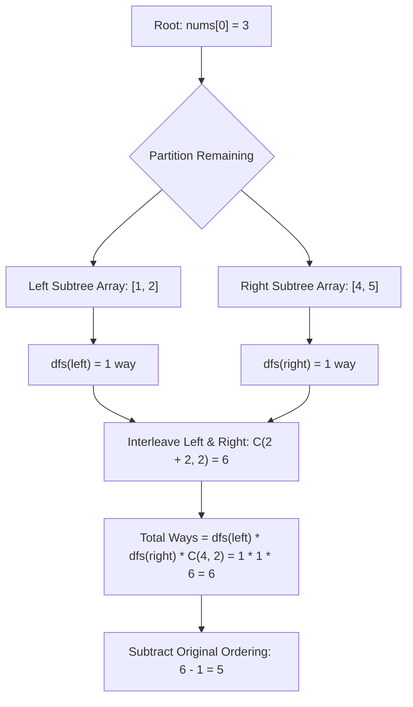

<h2><a href="https://leetcode.com/problems/number-of-ways-to-reorder-array-to-get-same-bst">1569. Number of Ways to Reorder Array to Get Same BST</a></h2>

<p>Given an array <code>nums</code> that represents a permutation of integers from <code>1</code> to <code>n</code>. We are going to construct a binary search tree (BST) by inserting the elements of <code>nums</code> in order into an initially empty BST. Find the number of different ways to reorder <code>nums</code> so that the constructed BST is identical to that formed from the original array <code>nums</code>.</p>

<ul>
	<li>For example, given <code>nums = [2,1,3]</code>, we will have 2 as the root, 1 as a left child, and 3 as a right child. The array <code>[2,3,1]</code> also yields the same BST but <code>[3,2,1]</code> yields a different BST.</li>
</ul>

<p>Return <em>the number of ways to reorder</em> <code>nums</code> <em>such that the BST formed is identical to the original BST formed from</em> <code>nums</code>.</p>

<p>Since the answer may be very large, <strong>return it modulo </strong><code>10<sup>9</sup> + 7</code>.</p>

<p>&nbsp;</p>
<p><strong class="example">Example 1:</strong></p>

<pre><strong>Input:</strong> nums = [2,1,3]
<strong>Output:</strong> 1
<strong>Explanation:</strong> We can reorder nums to be [2,3,1] which will yield the same BST. There are no other ways to reorder nums which will yield the same BST.
</pre>

<p><strong class="example">Example 2:</strong></p>

<pre><strong>Input:</strong> nums = [3,4,5,1,2]
<strong>Output:</strong> 5
<strong>Explanation:</strong> The following 5 arrays will yield the same BST: 
[3,1,2,4,5]
[3,1,4,2,5]
[3,1,4,5,2]
[3,4,1,2,5]
[3,4,1,5,2]
</pre>

<p><strong class="example">Example 3:</strong></p>

<pre><strong>Input:</strong> nums = [1,2,3]
<strong>Output:</strong> 0
<strong>Explanation:</strong> There are no other orderings of nums that will yield the same BST.
</pre>

<p>&nbsp;</p>
<p><strong>Constraints:</strong></p>

<ul>
	<li><code>1 &lt;= nums.length &lt;= 1000</code></li>
	<li><code>1 &lt;= nums[i] &lt;= nums.length</code></li>
	<li>All integers in <code>nums</code> are <strong>distinct</strong>.</li>
</ul>


---

# 🛍️ Number-of-Ways-to-Reorder-Array-to-Get-Same-BST | Explained

## Approach 1: Divide and Conquer with Combinatorics (Pascal's Triangle)

### Intuition
When constructing a Binary Search Tree (BST) from an array, the very first element picked becomes the root. Every subsequent element is partitioned deterministically: values strictly smaller than the root populate the left subtree, and values strictly larger populate the right subtree. 

Crucially, the relative ordering *within* the left partition determines the shape of the left subtree, and the relative ordering *within* the right partition determines the shape of the right subtree. However, the interleaving between an element destined for the left subtree and an element destined for the right subtree does not affect the tree structure at all—as long as the root is placed first, any element of the left subtree can arrive before or after any element of the right subtree.

Think of it like two independent queues of passengers boarding a bus: one queue heading to the left row of seats, the other to the right row. Within each queue, passengers must maintain their order to get their designated seat. But the bus driver doesn't care if a passenger from the left queue boards before or after a passenger from the right queue. The total number of valid boarding sequences is simply the number of ways to interleave the two queues: $\binom{\text{total remaining spots}}{\text{spots for left queue}}$.

By recursively computing the valid orderings for the left and right subtrees and multiplying them by the combination count $\binom{L + R}{L}$, we obtain the total valid permutations. Finally, we subtract 1 because the original array configuration itself does not count as a "reordering."

### Algorithm Visualized



### Approach
1. **Precompute Combinations (Pascal's Triangle):**
   - The number of ways to interleave two arrays of lengths $L$ and $R$ is $\binom{L + R}{L}$.
   - Given $N \le 1000$, we precompute binomial coefficients $\binom{n}{k} \pmod{10^9 + 7}$ using Pascal's Identity: $\binom{n}{k} = \binom{n-1}{k-1} + \binom{n-1}{k}$ in $O(N^2)$ time. This avoids modular inverse computations.
2. **Recursive Partitioning (`dfs`):**
   - **Base Case:** If an array has fewer than 3 elements ($m < 3$), there is only $1$ way to order them to retain their BST structure (0 elements = 1 way, 1 element = 1 way, 2 elements = root must come first, child second, so only 1 way).
   - **Partitioning:** Pick `nums[0]` as the root. Iterate through `nums[1 \dots m-1]` and append values less than the root to `leftNodes`, and values greater to `rightNodes`.
   - **Recursive Step:** Compute `leftWays = dfs(leftNodes)` and `rightWays = dfs(rightNodes)`.
   - **Combine:** The ways to assemble this subtree is:
     $$\text{Total} = (\text{leftWays} \times \text{rightWays} \pmod{10^9+7}) \times \binom{m - 1}{|leftNodes|} \pmod{10^9+7}$$
3. **Subtract Original Array:**
   - The problem asks for the number of *reorderings* different from the initial array. Thus, the final answer is $(\text{dfs(nums)} - 1) \pmod{10^9 + 7}$.

### Detailed Code Analysis

- **Lines 3–12 (`numOfWays` - Pascal's Triangle Precomputation):**
  ```cpp
  int m = nums.size();
  table.resize(m + 1);
  for(int i = 0; i < m + 1; ++i) {
      table[i] = vector<long long>(i + 1, 1);
      for(int j = 1; j < i; ++j) {
          table[i][j] = (table[i - 1][j - 1] + table[i - 1][j]) % mod;
      }
  }
  ```
  Initializes a dynamic programming table representing Pascal's triangle up to size $m$. For each row $i$, boundary elements ($\binom{i}{0}$ and $\binom{i}{i}$) are initialized to `1`. Every intermediate cell $j$ is computed as the sum of the two cells directly above it, taken modulo $10^9 + 7$.

- **Line 13 (`return (dfs(nums) - 1) % mod;`):**
  Calls the recursive function starting with the entire initial array. It subtracts `1` to exclude the initial permutation provided in the input. In C++, if `dfs(nums)` were 0, subtracting 1 could produce a negative result, but since any valid BST permutation array yields $\ge 1$ ways, `dfs(nums) - 1` is guaranteed to be non-negative.

- **Lines 18–22 (`dfs` Base Case):**
  ```cpp
  int m = nums.size();
  if(m < 3) {
      return 1;
  }
  ```
  If the current subproblem contains 0, 1, or 2 elements, there is only one valid relative ordering that preserves the BST structure.

- **Lines 23–30 (Partitioning Left and Right Elements):**
  ```cpp
  vector<int> leftNodes, rightNodes;
  for(int i = 1; i < m; ++i){
      if (nums[i] < nums[0]) {
          leftNodes.push_back(nums[i]);
      } else {
          rightNodes.push_back(nums[i]);
      }
  }
  ```
  The first element `nums[0]` is the local root. By iterating from index `1` to `m - 1`, we preserve the relative arrival order of elements within the left and right subtrees while partitioning them based on BST properties.

- **Lines 31–33 (Recursive Calculation and Interleaving Combination):**
  ```cpp
  long long leftWays = dfs(leftNodes) % mod;
  long long rightWays = dfs(rightNodes) % mod;
  return (((leftWays * rightWays) % mod) * table[m - 1][leftNodes.size()]) % mod;
  ```
  We recursively evaluate `dfs` for both child vectors. The total remaining open slots across both subtrees is $m - 1$. The number of ways to pick indices for the left subtree elements out of the $m - 1$ slots is given by $\binom{m - 1}{|leftNodes|}$, accessible via `table[m - 1][leftNodes.size()]`. All intermediate multiplications use `long long` to prevent 32-bit integer overflow prior to modulo reduction.

### Code

```cpp
class Solution {
public:
    int numOfWays(vector<int>& nums) {
        int m = nums.size();
        // Table of Pascal's triangle
        table.resize(m + 1);
        for(int i = 0; i < m + 1; ++i) {
            table[i] = vector<long long>(i + 1, 1);
            for(int j = 1; j < i; ++j) {
                table[i][j] = (table[i - 1][j - 1] + table[i - 1][j]) % mod;
            }
        }
        return (dfs(nums) - 1) % mod;
    }
private:
    vector<vector<long long>> table;
    long long mod = 1e9 + 7;
    long long dfs(vector<int> &nums){
        int m = nums.size();
        if(m < 3) {
            return 1;
        }
        vector<int> leftNodes, rightNodes;
        for(int i = 1; i < m; ++i){
            if (nums[i] < nums[0]) {
                leftNodes.push_back(nums[i]);
            } else {
                rightNodes.push_back(nums[i]);
            }
        }
        long long leftWays = dfs(leftNodes) % mod;
        long long rightWays = dfs(rightNodes) % mod;
        return (((leftWays * rightWays) % mod) * table[m - 1][leftNodes.size()]) % mod;
    }
};
```

### Complexity

- **Time Complexity:** 
  - **Pascal's Triangle Precomputation:** Computing the combination table up to size $N + 1$ takes $O(N^2)$ time.
  - **DFS Traversal:** At each recursion level, partitioning takes $O(m)$ where $m$ is the length of the current sub-array. In the worst case (a completely skewed tree like a linked list), the recursion depth is $N$, resulting in $\sum_{i=1}^N i = O(N^2)$ work. In the best/average case (a balanced tree), recursion depth is $O(\log N)$, and the work per level is $O(N)$, giving $O(N \log N)$.
  - **Total Time:** Dominated by $O(N^2)$ due to the Pascal table and worst-case recursion.

- **Space Complexity:**
  - **Pascal's Table:** Requires $O(N^2)$ space to store the combinations up to $(N + 1) \times (N + 1)$.
  - **Recursion Call Stack & Vector Allocations:** At each level of recursion, vectors `leftNodes` and `rightNodes` are allocated. In the worst-case skewed tree, recursion depth is $O(N)$, and the total memory across all active stack frames is $O(N^2)$. In a balanced tree, space across the stack frames is $O(N)$.
  - **Total Space:** $O(N^2)$ auxiliary space.

---

## 🕵️‍♂️ Follow-up Questions

### 1. How can you optimize the space complexity from $O(N^2)$ to $O(N)$?
Instead of precomputing Pascal's triangle in an $O(N^2)$ 2D matrix, we can precompute factorials and inverse factorials up to $N$ in $O(N)$ time using Fermat's Little Theorem:
$$\binom{n}{k} = n! \times (k!)^{-1} \times ((n-k)!)^{-1} \pmod{10^9 + 7}$$
This reduces the combination lookup storage to $O(N)$ for the factorial arrays. Furthermore, instead of creating new sub-vectors at each recursive call, one could pass indices or an auxiliary index mapping array to avoid re-allocating memory, keeping the auxiliary space bounded by $O(N)$.

### 2. What would happen if duplicate values were allowed in the input array?
A standard BST handles duplicates by either placing them strictly into the left or right subtree (e.g., $\le$ goes left). However, if identical elements exist, permutations swapping identical elements would produce duplicate sequences unless handled with multinomial coefficients. The problem statement guarantees that `nums` consists of distinct positive integers, avoiding duplicate sequence ambiguity.