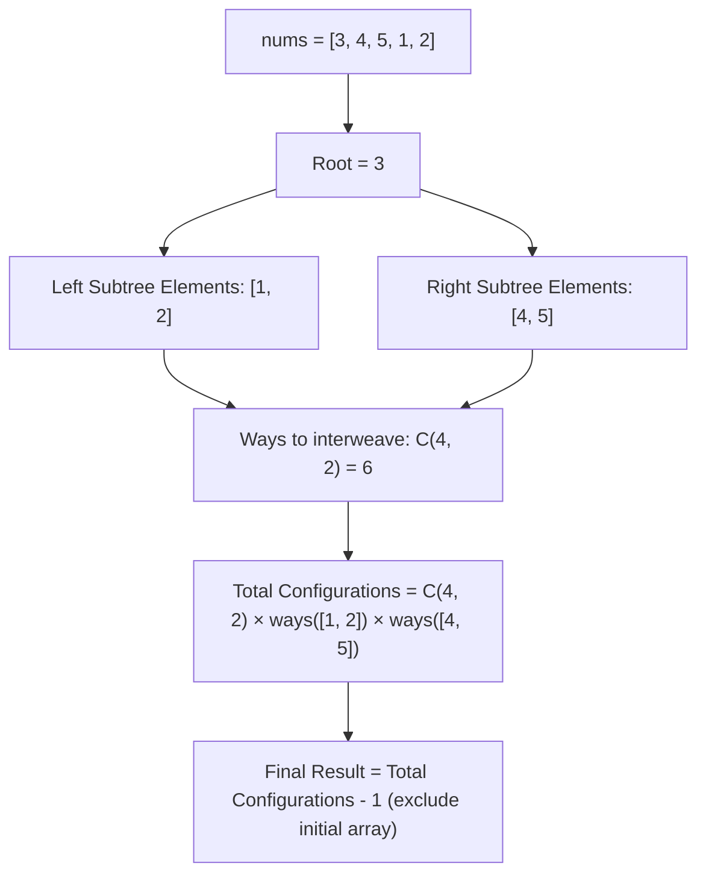

<h2><a href="https://leetcode.com/problems/number-of-ways-to-reorder-array-to-get-same-bst">1569. Number of Ways to Reorder Array to Get Same BST</a></h2>

<p>Given an array <code>nums</code> that represents a permutation of integers from <code>1</code> to <code>n</code>. We are going to construct a binary search tree (BST) by inserting the elements of <code>nums</code> in order into an initially empty BST. Find the number of different ways to reorder <code>nums</code> so that the constructed BST is identical to that formed from the original array <code>nums</code>.</p>

<ul>
	<li>For example, given <code>nums = [2,1,3]</code>, we will have 2 as the root, 1 as a left child, and 3 as a right child. The array <code>[2,3,1]</code> also yields the same BST but <code>[3,2,1]</code> yields a different BST.</li>
</ul>

<p>Return <em>the number of ways to reorder</em> <code>nums</code> <em>such that the BST formed is identical to the original BST formed from</em> <code>nums</code>.</p>

<p>Since the answer may be very large, <strong>return it modulo </strong><code>10<sup>9</sup> + 7</code>.</p>

<p>&nbsp;</p>
<p><strong class="example">Example 1:</strong></p>

<pre><strong>Input:</strong> nums = [2,1,3]
<strong>Output:</strong> 1
<strong>Explanation:</strong> We can reorder nums to be [2,3,1] which will yield the same BST. There are no other ways to reorder nums which will yield the same BST.
</pre>

<p><strong class="example">Example 2:</strong></p>

<pre><strong>Input:</strong> nums = [3,4,5,1,2]
<strong>Output:</strong> 5
<strong>Explanation:</strong> The following 5 arrays will yield the same BST: 
[3,1,2,4,5]
[3,1,4,2,5]
[3,1,4,5,2]
[3,4,1,2,5]
[3,4,1,5,2]
</pre>

<p><strong class="example">Example 3:</strong></p>

<pre><strong>Input:</strong> nums = [1,2,3]
<strong>Output:</strong> 0
<strong>Explanation:</strong> There are no other orderings of nums that will yield the same BST.
</pre>

<p>&nbsp;</p>
<p><strong>Constraints:</strong></p>

<ul>
	<li><code>1 &lt;= nums.length &lt;= 1000</code></li>
	<li><code>1 &lt;= nums[i] &lt;= nums.length</code></li>
	<li>All integers in <code>nums</code> are <strong>distinct</strong>.</li>
</ul>


---

# 🛍️ Number-of-Ways-to-Reorder-Array-to-Get-Same-BST | Explained

## Approach 1: Divide and Conquer with Combinatorics (Pascal's Triangle)

### Intuition
To construct an identical Binary Search Tree (BST), the first element in the array must always be chosen as the root. Once the root is fixed, all numbers strictly smaller than the root must reside in the left subtree, and all numbers strictly larger must reside in the right subtree.

Think of it like two independent lines of people waiting to merge into a single line behind a VIP (the root). One line consists of people going to the left room, and the other consists of people going to the right room. As long as the people heading to the left room preserve their relative order among themselves, and the people heading to the right room preserve their relative order among themselves, the exact same BST will be formed. 

Out of the total remaining slots $(|left| + |right|)$, we simply need to choose which $|left|$ slots will be occupied by the elements of the left subtree. The number of ways to interleave these two sequences without changing their internal order is given by the combination formula:

$$\binom{|left| + |right|}{|left|} = \binom{m - 1}{|left|}$$

This property holds recursively for every subtree.

### Algorithm Visualized



### Approach
1. **Precompute Combinations with Pascal's Triangle:**
   - To compute $\binom{n}{k} \pmod{10^9 + 7}$ efficiently without modular division/inverse, precompute Pascal's triangle up to size $m \times m$, where $m$ is the length of `nums`.
   - Relation: $\binom{n}{k} = \binom{n-1}{k-1} + \binom{n-1}{k}$.

2. **Recursive Decomposition (`dfs`):**
   - **Base Case:** If a sequence has $\le 2$ elements, there is only $1$ way to order them (the relative order is uniquely determined). Return $1$.
   - **Partition:** Designate `nums[0]` as the root. Iterate through `nums[1 \dots m-1]` and distribute elements smaller than `nums[0]` into vector `left`, and larger elements into vector `right`.
   - **Recurse:** Find the number of valid sequences for both subtrees:
     $$\text{left\_ways} = \text{dfs}(left)$$
     $$\text{right\_ways} = \text{dfs}(right)$$
   - **Combine:** The total ways for the current tree is the number of interleavings multiplied by the independent ways to arrange each subtree:
     $$\text{ways} = \binom{m - 1}{|left|} \times \text{left\_ways} \times \text{right\_ways} \pmod{10^9 + 7}$$

3. **Subtract the Original Array:**
   - The problem asks for the number of *reorderings* that produce the same BST. Since the initial arrangement is already one of the valid formations, subtract $1$ from the final answer: `(dfs(nums) - 1 + mod) % mod`.

### Detailed Code Analysis

- **`table.resize(m + 1);`**: Prepares an $(m + 1) \times (m + 1)$ 2D vector to store combinations dynamically.
- **Pascal's Triangle Initialization (`table[i][j] = (table[i - 1][j - 1] + table[i - 1][j]) % mod;`)**: Dynamically fills the combinations modulo $10^9 + 7$. This avoids overflow and avoids the $O(\log(\text{mod}))$ cost of modular inverse arithmetic.
- **`if (m <= 2) return 1;`**: If the array has $0, 1,$ or $2$ elements, the order of insertion to maintain tree structure cannot be altered without changing the root.
- **Partitioning Loop (`for(int i = 1; i < m; ++i)`)**: 
  - Iterates through the rest of the array.
  - If `nums[i] < nums[0]`, it is placed into `left`.
  - Otherwise, it is placed into `right`.
  - Relative order among left elements and right elements is strictly preserved.
- **Modular Multiplication**:
  ```cpp
  long long left_ways = dfs(left);
  long long right_ways = dfs(right);
  return (((table[m - 1][left.size()] * left_ways) % mod) * right_ways) % mod;
  ```
  Applies the product rule modulo $10^9 + 7$ by multiplying interleaving options $\binom{m - 1}{|left|}$ with the recursive subproblem results.
- **`return (dfs(nums) - 1 + mod) % mod;`**: Subtracts the initial permutation. Adding `mod` before `% mod` prevents negative values if `dfs(nums) == 0` (though `dfs` is $\ge 1$ here, it is defensive programming for modular arithmetic).

### Code

```cpp
#include <vector>

using namespace std;

class Solution {
public:
    int numOfWays(vector<int>& nums) {
        int m = nums.size();
        
        // Table of Pascal's triangle
        table.resize(m + 1);
        for(int i = 0; i < m + 1; ++i) {
            table[i] = vector<long long>(i + 1, 1);
            for(int j = 1; j < i; ++j) {
                table[i][j] = (table[i - 1][j - 1] + table[i - 1][j]) % mod;
            }
        }
        
        return (dfs(nums) - 1 + mod) % mod;
    }

private:
    vector<vector<long long>> table;
    long long mod = 1e9 + 7;

    long long dfs(vector<int> &nums) {
        int m = nums.size();
        if (m <= 2) return 1;

        vector<int> left;
        vector<int> right;
        int root = nums[0];

        for (int i = 1; i < m; ++i) {
            if (nums[i] < root) {
                left.push_back(nums[i]);
            } else {
                right.push_back(nums[i]);
            }
        }

        long long left_ways = dfs(left);
        long long right_ways = dfs(right);

        // table[total_elements - 1][left_elements]
        long long ways = (table[m - 1][left.size()] * left_ways) % mod;
        return (ways * right_ways) % mod;
    }
};
```

### Complexity
- **Time Complexity:**
  - **Pascal's Triangle:** Filling the table takes $\sum_{i=0}^{m} i = O(m^2)$ time.
  - **DFS Recursion:** At each recursion level, iterating over elements to partition takes $O(k)$ where $k$ is the current array length. In the worst case (a completely skewed tree, like a sorted array), the depth of the recursion tree is $O(m)$, leading to $\sum_{k=1}^{m} k = O(m^2)$ operations. In the best case (a balanced tree), it satisfies $T(m) = 2T(m/2) + O(m) \implies O(m \log m)$.
  - **Overall Time Complexity:** $O(m^2)$ where $m$ is the number of elements in `nums`.

- **Space Complexity:**
  - **Combinations Table:** The Pascal table stores $\frac{m(m + 1)}{2}$ entries, requiring $O(m^2)$ space.
  - **Recursion Call Stack & Sub-arrays:** The call stack depth is $O(m)$ in the worst case. Across a branch of recursion, dynamically allocating auxiliary vectors `left` and `right` takes $O(m^2)$ cumulative temporary memory.
  - **Overall Space Complexity:** $O(m^2)$.

---

## 🕵️‍♂️ Follow-up Questions (Optional)

1. **How can you reduce the auxiliary space from $O(m^2)$ to $O(m)$?**
   - Instead of building a 2D Pascal triangle, precompute factorials and inverse factorials up to $m$ using Fermat’s Little Theorem ($a^{p-2} \equiv a^{-1} \pmod p$). This reduces the combination lookup table from an $O(m^2)$ 2D table to two $1$D arrays of size $O(m)$.

2. **Can the time complexity be improved if the input tree is skewed?**
   - The time spent partitioning each subproblem is bounded by the construction of sub-vectors. By indexing or creating an explicit Cartesian Tree / BST first and using tree subtree sizes, combination calculations can be performed in $O(m)$ time after an initial $O(m \log m)$ or $O(m^2)$ tree build.