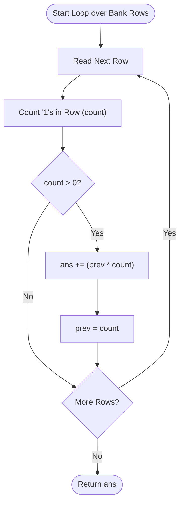

<h2><a href="https://leetcode.com/problems/number-of-laser-beams-in-a-bank">2125. Number of Laser Beams in a Bank</a></h2>

<p>Anti-theft security devices are activated inside a bank. You are given a <strong>0-indexed</strong> binary string array <code>bank</code> representing the floor plan of the bank, which is an <code>m x n</code> 2D matrix. <code>bank[i]</code> represents the <code>i<sup>th</sup></code> row, consisting of <code>'0'</code>s and <code>'1'</code>s. <code>'0'</code> means the cell is empty, while<code>'1'</code> means the cell has a security device.</p>

<p>There is <strong>one</strong> laser beam between any <strong>two</strong> security devices <strong>if both</strong> conditions are met:</p>

<ul>
	<li>The two devices are located on two <strong>different rows</strong>: <code>r<sub>1</sub></code> and <code>r<sub>2</sub></code>, where <code>r<sub>1</sub> &lt; r<sub>2</sub></code>.</li>
	<li>For <strong>each</strong> row <code>i</code> where <code>r<sub>1</sub> &lt; i &lt; r<sub>2</sub></code>, there are <strong>no security devices</strong> in the <code>i<sup>th</sup></code> row.</li>
</ul>

<p>Laser beams are independent, i.e., one beam does not interfere nor join with another.</p>

<p>Return <em>the total number of laser beams in the bank</em>.</p>

<p>&nbsp;</p>
<p><strong class="example">Example 1:</strong></p>

<pre><strong>Input:</strong> bank = ["011001","000000","010100","001000"]
<strong>Output:</strong> 8
<strong>Explanation:</strong> Between each of the following device pairs, there is one beam. In total, there are 8 beams:
 * bank[0][1] -- bank[2][1]
 * bank[0][1] -- bank[2][3]
 * bank[0][2] -- bank[2][1]
 * bank[0][2] -- bank[2][3]
 * bank[0][5] -- bank[2][1]
 * bank[0][5] -- bank[2][3]
 * bank[2][1] -- bank[3][2]
 * bank[2][3] -- bank[3][2]
Note that there is no beam between any device on the 0<sup>th</sup> row with any on the 3<sup>rd</sup> row.
This is because the 2<sup>nd</sup> row contains security devices, which breaks the second condition.
</pre>

<p><strong class="example">Example 2:</strong></p>

<pre><strong>Input:</strong> bank = ["000","111","000"]
<strong>Output:</strong> 0
<strong>Explanation:</strong> There does not exist two devices located on two different rows.
</pre>

<p>&nbsp;</p>
<p><strong>Constraints:</strong></p>

<ul>
	<li><code>m == bank.length</code></li>
	<li><code>n == bank[i].length</code></li>
	<li><code>1 &lt;= m, n &lt;= 500</code></li>
	<li><code>bank[i][j]</code> is either <code>'0'</code> or <code>'1'</code>.</li>
</ul>


---

# 🛍️ Number-of-Laser-Beams-in-a-Bank | Explained

## Approach 1: Single Pass with State Tracking (Consecutive Non-Empty Row Multiplication)

### Intuition
Think of each floor in the bank as a stage in a multi-story atrium. Security cameras are positioned on certain floors, and every camera on an active floor must project a beam to every camera on the *next available floor* that actually has cameras. Floors without any cameras are completely transparent—the laser beams simply bypass them.

Because every camera on floor $A$ connects to every camera on the subsequent active floor $B$, the total number of beams between those two floors follows the fundamental counting principle: if floor $A$ has $m$ cameras and floor $B$ has $n$ cameras, there are $m \times n$ beams connecting them. We do not need to compare all pairs of rows or store historical data; we only need to remember the number of devices on the *immediately preceding active row*.

### Algorithm Visualized



### Approach
1. **Initialize Accumulators:**
   - Maintain `ans` to store the total beam count.
   - Maintain `prev` to track the number of devices found in the most recent row that contained at least one device. Initialize `prev = 0` so that the very first populated row does not erroneously generate beams with a non-existent previous row.

2. **Iterate Row by Row:**
   - For every binary string in the bank, count how many security devices (`'1'`) are present.
   - If the current row contains zero devices (`count == 0`), simply skip it. It cannot emit or receive laser beams, nor does it block beams passing between rows above and below it.

3. **Compute and Advance:**
   - If the current row has devices (`count > 0`):
     - Calculate the beams formed between the last active row and this row: `prev * count`.
     - Add this value to `ans`.
     - Update `prev` to `count`, making this row the new reference point for any subsequent active rows.

4. **Termination:**
   - Return `ans` after all rows are processed.

### Detailed Code Analysis

```cpp
class Solution {
public:
    int numberOfBeams(vector<string>& bank) {
        // 'prev' stores the device count of the previous non-empty row.
        // 'ans' accumulates the total laser beams formed across all pairs.
        int prev = 0, ans = 0;
        
        // Iterate through each row in the bank grid.
        // Note: 'string s' makes a copy of each string per iteration.
        for (string s : bank) {
            int count = 0;
            
            // Count security devices ('1') in the current row.
            for (char c : s) {
                if (c == '1') {
                    count++;
                }
            }
            
            // A row only participates in beam creation if it has at least one device.
            if (count != 0) {
                // Number of beams between previous active row and current row
                ans += (prev * count);
                
                // Shift the window: the current row becomes the 'prev' for future rows.
                prev = count;
            }
        }
        
        return ans;
    }
};
```

- **Lines 4:** `int prev = 0, ans = 0;` initializes the laser beam accumulator and previous device counter. Starting `prev = 0` ensures that the first active row contributes `0 * count = 0` beams, properly handling the boundary condition without special casing.
- **Line 6:** `for (string s : bank)` iterates over the vector of row strings.
- **Lines 7–12:** `int count = 0; for (char c : s) { if (c == '1') count++; }` scans the current row character-by-character to tally the active devices.
- **Lines 13–16:** `if (count != 0)` filters out rows with zero devices. If devices are present:
  - `ans += (prev * count);` executes the Cartesian product between devices on the current and previous active rows.
  - `prev = count;` updates the state so subsequent rows connect to this row.
- **Line 19:** `return ans;` returns the accumulated sum after inspecting all floors.

### Code
```cpp
class Solution {
public:
    int numberOfBeams(vector<string>& bank) {
        int prev = 0, ans = 0;
        
        for (string s : bank) {
            int count = 0;
            for (char c : s) {
                if (c == '1') {
                    count++;
                }
            }
            if (count != 0) {
                ans += (prev * count);
                prev = count;
            }
        }
        
        return ans;
    }
};
```

### Complexity
- **Time Complexity:** $\mathcal{O}(M \times N)$
  Where $M$ is the number of rows in `bank` (`bank.size()`) and $N$ is the length of each string (`bank[0].size()`). Every character in the grid is visited exactly once during the inner character-counting loop.
- **Space Complexity:** $\mathcal{O}(1)$ auxiliary space (ignoring string copy).
  The algorithm only tracks scalar variables (`prev`, `ans`, `count`). 
  *Note:* Because the loop uses `for (string s : bank)` instead of `for (const string& s : bank)`, each row string is copied, which uses $\mathcal{O}(N)$ dynamic allocation per iteration. Using a `const` reference reduces auxiliary space strictly to $\mathcal{O}(1)$.

---

## 🕵️‍♂️ Follow-up Questions

### 1. How would you optimize this implementation for modern C++ standards and cache efficiency?
Instead of manually looping through characters with an unnecessary string copy, use `const string&` and standard algorithms like `std::count`:
```cpp
for (const string& s : bank) {
    int count = std::count(s.begin(), s.end(), '1');
    if (count > 0) {
        ans += prev * count;
        prev = count;
    }
}
```
`std::count` is often vectorized (SIMD) by optimizing compilers, significantly speeding up execution on large string lengths.

### 2. Can integer overflow occur in `ans += (prev * count)`?
Given the problem constraints on LeetCode ($M, N \le 500$):
- Maximum devices per row: $500$
- Maximum beams between two adjacent rows: $500 \times 500 = 250,000$
- Maximum total rows: $500$
- Maximum total beams: $\approx 250 \times 250,000 \approx 6.25 \times 10^7$

Because $6.25 \times 10^7$ is well within the 32-bit signed integer limit ($2^{31} - 1 \approx 2.14 \times 10^9$), standard 32-bit `int` will not overflow. However, if $M, N \ge 10^5$, `ans` would need to be upgraded to `long long`.