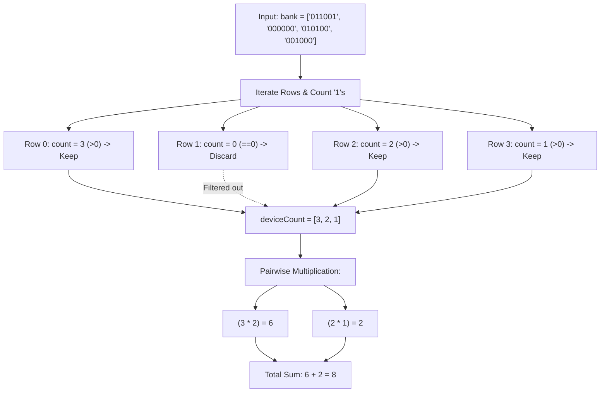

<h2><a href="https://leetcode.com/problems/number-of-laser-beams-in-a-bank">2125. Number of Laser Beams in a Bank</a></h2>

<p>Anti-theft security devices are activated inside a bank. You are given a <strong>0-indexed</strong> binary string array <code>bank</code> representing the floor plan of the bank, which is an <code>m x n</code> 2D matrix. <code>bank[i]</code> represents the <code>i<sup>th</sup></code> row, consisting of <code>'0'</code>s and <code>'1'</code>s. <code>'0'</code> means the cell is empty, while<code>'1'</code> means the cell has a security device.</p>

<p>There is <strong>one</strong> laser beam between any <strong>two</strong> security devices <strong>if both</strong> conditions are met:</p>

<ul>
	<li>The two devices are located on two <strong>different rows</strong>: <code>r<sub>1</sub></code> and <code>r<sub>2</sub></code>, where <code>r<sub>1</sub> &lt; r<sub>2</sub></code>.</li>
	<li>For <strong>each</strong> row <code>i</code> where <code>r<sub>1</sub> &lt; i &lt; r<sub>2</sub></code>, there are <strong>no security devices</strong> in the <code>i<sup>th</sup></code> row.</li>
</ul>

<p>Laser beams are independent, i.e., one beam does not interfere nor join with another.</p>

<p>Return <em>the total number of laser beams in the bank</em>.</p>

<p>&nbsp;</p>
<p><strong class="example">Example 1:</strong></p>

<pre><strong>Input:</strong> bank = ["011001","000000","010100","001000"]
<strong>Output:</strong> 8
<strong>Explanation:</strong> Between each of the following device pairs, there is one beam. In total, there are 8 beams:
 * bank[0][1] -- bank[2][1]
 * bank[0][1] -- bank[2][3]
 * bank[0][2] -- bank[2][1]
 * bank[0][2] -- bank[2][3]
 * bank[0][5] -- bank[2][1]
 * bank[0][5] -- bank[2][3]
 * bank[2][1] -- bank[3][2]
 * bank[2][3] -- bank[3][2]
Note that there is no beam between any device on the 0<sup>th</sup> row with any on the 3<sup>rd</sup> row.
This is because the 2<sup>nd</sup> row contains security devices, which breaks the second condition.
</pre>

<p><strong class="example">Example 2:</strong></p>

<pre><strong>Input:</strong> bank = ["000","111","000"]
<strong>Output:</strong> 0
<strong>Explanation:</strong> There does not exist two devices located on two different rows.
</pre>

<p>&nbsp;</p>
<p><strong>Constraints:</strong></p>

<ul>
	<li><code>m == bank.length</code></li>
	<li><code>n == bank[i].length</code></li>
	<li><code>1 &lt;= m, n &lt;= 500</code></li>
	<li><code>bank[i][j]</code> is either <code>'0'</code> or <code>'1'</code>.</li>
</ul>


---

# 🛍️ Number-of-Laser-Beams-in-a-Bank | Explained

## Approach 1: Intermediate Device Count Filtering (Two-Pass with List)

### Intuition
Think of the bank as a multi-story building where each floor either has security guards (`1`) or is completely empty (`0`). Lasers can only pass between floors if there are no intermediate floors containing security guards to intercept them. This means completely empty floors are essentially transparent—they do not block lasers and they do not generate lasers. 

Therefore, any empty floor can be entirely disregarded. If Floor A has $X$ guards and the very next non-empty floor, Floor B, has $Y$ guards, every single guard on Floor A connects to every single guard on Floor B. By the fundamental counting principle, the total number of beams formed between these two floors is simply $X \times Y$. By first filtering out all the empty floors into a list, the problem reduces to multiplying adjacent elements in that list and summing the results.

### Algorithm Visualized



### Approach
1. **Count Security Devices per Row**:
   - Traverse the `bank` array row by row.
   - For each row, count the occurrences of the character `'1'`.
2. **Filter Out Empty Rows**:
   - If a row contains at least one device (`count > 0`), store that count in an auxiliary list (`deviceCount`).
   - If a row has zero devices (`count == 0`), simply ignore it, as it neither initiates nor terminates laser beams.
3. **Calculate Total Beams**:
   - Iterate through the `deviceCount` list up to the second-to-last element (`size - 1`).
   - Multiply the count of devices in the current row (`deviceCount.get(i)`) by the count in the subsequent valid row (`deviceCount.get(i + 1)`).
   - Accumulate these products into `ans`.
4. **Return Result**:
   - Return the total accumulated beam count.

### Detailed Code Analysis

```java
int row = bank.length;
int ans = 0;
ArrayList<Integer> deviceCount = new ArrayList<>();
```
- `row`: Stores the total number of rows (floors) in the bank.
- `ans`: The running accumulator for the total number of laser beams.
- `deviceCount`: An `ArrayList<Integer>` used as an intermediate buffer to record the number of devices on non-empty rows in their original sequential order.

```java
for (int i = 0; i < row; i++){
    String curr = bank[i];
    int count = 0;
    for (int j = 0; j < curr.length(); j++){
        if (curr.charAt(j) == '1'){
            count++;
        }
    }
    if(count > 0) deviceCount.add(count);
}
```
- **Outer Loop (`i`)**: Iterates through each binary string representing a row in the bank.
- **Inner Loop (`j`)**: Scans through each character of the string `curr`. When a `'1'` is encountered, `count` is incremented.
- **Conditional Addition (`if(count > 0)`)**: Only rows containing at least one laser device are pushed to `deviceCount`. This step strips out inactive rows that would otherwise interrupt direct laser transmission logic.

```java
for(int i = 0; i < deviceCount.size() - 1; i++){
    ans += deviceCount.get(i) * deviceCount.get(i + 1);
}
return ans;
```
- **Adjacent Product Loop**: Loops from index `0` to `deviceCount.size() - 2`. 
- `deviceCount.get(i) * deviceCount.get(i + 1)`: Multiplies every device on the current active row by every device on the next active row, representing all possible unique connecting beams.
- Returns `ans`. If there are fewer than 2 active rows, `deviceCount.size() - 1` evaluates to $\le 0$, the loop is skipped, and the initial value `0` is correctly returned.

### Code
```java
class Solution {
    public int numberOfBeams(String[] bank) {
        int row = bank.length;
        int ans = 0;
        ArrayList<Integer> deviceCount = new ArrayList<>();
        for (int i = 0; i < row; i++) {
            String curr = bank[i];
            int count = 0;
            for (int j = 0; j < curr.length(); j++) {
                if (curr.charAt(j) == '1') {
                    count++;
                }
            }
            if (count > 0) deviceCount.add(count);
        }
        for (int i = 0; i < deviceCount.size() - 1; i++) {
            ans += deviceCount.get(i) * deviceCount.get(i + 1);
        }
        return ans;
    }
}
```

### Complexity
- **Time Complexity:** $\mathcal{O}(M \times N)$
  - Let $M$ be the number of rows (`bank.length`) and $N$ be the length of each string (`bank[0].length()`).
  - Scanning every character in the grid takes $\mathcal{O}(M \times N)$ time.
  - The second loop iterates through `deviceCount`, which has a maximum size of $M$. Iterating and multiplying takes $\mathcal{O}(M)$ time.
  - Total Time: $\mathcal{O}(M \times N) + \mathcal{O}(M) = \mathcal{O}(M \times N)$.
- **Space Complexity:** $\mathcal{O}(M)$
  - In the worst case (every row contains at least one `'1'`), `deviceCount` stores an entry for every row, requiring $\mathcal{O}(M)$ extra auxiliary space.

---

## 🕵️‍♂️ Follow-up Questions

### 1. Can we optimize the space complexity to $\mathcal{O}(1)$?
**Answer:** Yes. Notice that to calculate the beams formed with the current row, you only need the device count of the **immediately preceding non-empty row**. 
Instead of storing all row counts in an `ArrayList`, maintain a single variable `prevCount = 0`. As you scan row by row:
1. Count devices in the current row (`currCount`).
2. If `currCount > 0`:
   - Add `prevCount * currCount` to `ans`.
   - Update `prevCount = currCount`.
This reduces extra auxiliary space from $\mathcal{O}(M)$ to $\mathcal{O}(1)$ while maintaining single-pass processing.

### 2. Can integer overflow occur if the constraints are large?
**Answer:** In LeetCode's constraints ($M, N \le 500$), the maximum devices per row is $500$, and the maximum beams between two rows is $500 \times 500 = 250,000$. Over 500 rows, the maximum total beams would be roughly $500 \times 250,000 \approx 1.25 \times 10^8$, which fits safely inside a standard signed 32-bit integer (max $\approx 2.14 \times 10^9$). However, if $M, N \ge 10^5$, `ans` would need to be a 64-bit integer (`long` in Java) to prevent integer overflow.