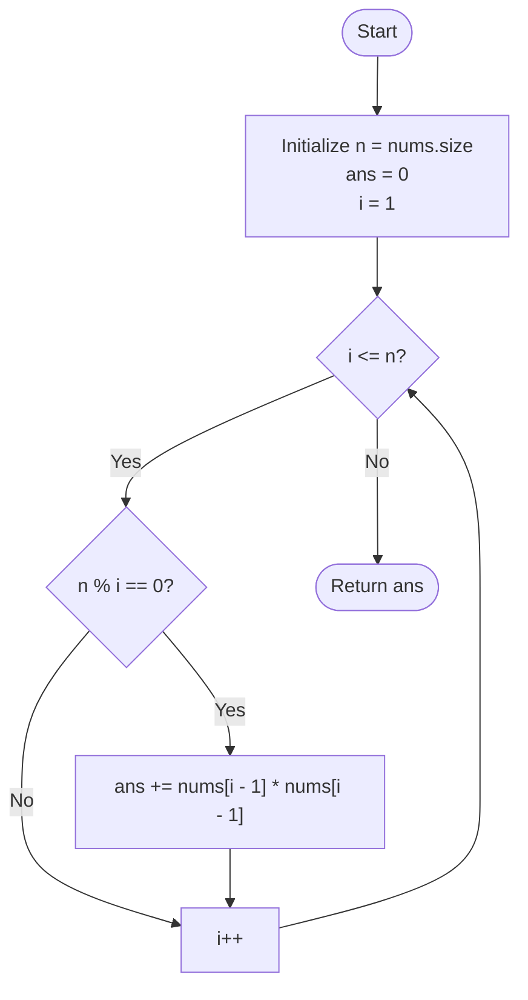

<h2><a href="https://leetcode.com/problems/sum-of-squares-of-special-elements">2778. Sum of Squares of Special Elements</a></h2>

<p>You are given a <strong>1-indexed</strong> integer array <code>nums</code> of length <code>n</code>.</p>

<p>An element <code>nums[i]</code> of <code>nums</code> is called <strong>special</strong> if <code>i</code> divides <code>n</code>, i.e. <code>n % i == 0</code>.</p>

<p>Return <em>the <strong>sum of the squares</strong> of all <strong>special</strong> elements of </em><code>nums</code>.</p>

<p>&nbsp;</p>
<p><strong class="example">Example 1:</strong></p>

<pre><strong>Input:</strong> nums = [1,2,3,4]
<strong>Output:</strong> 21
<strong>Explanation:</strong> There are exactly 3 special elements in nums: nums[1] since 1 divides 4, nums[2] since 2 divides 4, and nums[4] since 4 divides 4. 
Hence, the sum of the squares of all special elements of nums is nums[1] * nums[1] + nums[2] * nums[2] + nums[4] * nums[4] = 1 * 1 + 2 * 2 + 4 * 4 = 21.  
</pre>

<p><strong class="example">Example 2:</strong></p>

<pre><strong>Input:</strong> nums = [2,7,1,19,18,3]
<strong>Output:</strong> 63
<strong>Explanation:</strong> There are exactly 4 special elements in nums: nums[1] since 1 divides 6, nums[2] since 2 divides 6, nums[3] since 3 divides 6, and nums[6] since 6 divides 6. 
Hence, the sum of the squares of all special elements of nums is nums[1] * nums[1] + nums[2] * nums[2] + nums[3] * nums[3] + nums[6] * nums[6] = 2 * 2 + 7 * 7 + 1 * 1 + 3 * 3 = 63. 
</pre>

<p>&nbsp;</p>
<p><strong>Constraints:</strong></p>

<ul>
	<li><code>1 &lt;= nums.length == n &lt;= 50</code></li>
	<li><code>1 &lt;= nums[i] &lt;= 50</code></li>
</ul>


---

# 🛍️ Sum-of-Squares-of-Special-Elements | Explained

## Approach 1: Linear Divisor Scan (Direct Simulation)

### Intuition
Imagine you are organizing an event with $n$ attendees. You want to see which team sizes $i$ can divide the entire group evenly without leaving anyone out ($n \pmod i == 0$). Whenever you find such a valid team size $i$, you award bonus points to the person assigned to that slot, calculated as the square of their base score. 

Because the problem defines an element as "special" strictly when its 1-based index $i$ divides the total array length $n$ with a remainder of zero, the most direct way to solve this is to simply test every possible index from $1$ to $n$, verify divisibility, and accumulate the squared values.

### Algorithm Visualized



### Approach
1. **Determine Array Length:** Read the total count of elements $n$ from `nums.size()`.
2. **Initialize Accumulator:** Use an accumulator variable `ans` initialized to `0` to hold the running sum of squares.
3. **Loop Over 1-Based Indices:** Iterate through an index variable `i` starting at `1` and terminating at `n` (inclusive) to naturally mirror the 1-based indexing given in the problem statement.
4. **Evaluate Special Condition:** Check if $i$ is a divisor of $n$ using the modulo operator (`n % i == 0`).
5. **Convert Index and Accumulate:** If $i$ divides $n$, access the corresponding element at the 0-based offset `i - 1`. Square this value (`nums[i - 1] * nums[i - 1]`) and add it to `ans`.
6. **Return Result:** After the loop finishes checking all integers up to $n$, return `ans`.

### Detailed Code Analysis

```cpp
1class Solution {
2public:
3    int sumOfSquares(vector<int>& nums) {
```
- Defines the class `Solution` and the member function `sumOfSquares`. The input is passed as a reference to a `std::vector<int>`, which prevents unnecessary vector copying.

```cpp
4        int n=nums.size();
5        long long int ans = 0;
```
- **Line 4:** Captures the number of elements in the vector into variable `n`. Evaluating this once prevents calling `nums.size()` repeatedly during loop conditions and provides our dividend for the modulo operation.
- **Line 5:** Declares `ans` as a `long long int` initialized to `0`. While the function return type is `int`, choosing a 64-bit integer defensively guards against intermediate integer overflow before returning.

```cpp
6        for(int i=1; i<=n; i++){
7            if(n%i==0){
8                ans+= nums[i-1]*nums[i-1];
9            }
10       }
```
- **Line 6:** The `for` loop drives the 1-based index from `i = 1` up to `n`. 
- **Line 7:** `if (n % i == 0)` evaluates whether `i` is an exact divisor of `n`. This directly implements the problem's criteria for a "special element".
- **Line 8:** Because C++ vectors are 0-indexed, 1-based index `i` maps directly to memory index `i - 1`. The value `nums[i - 1]` is multiplied by itself to calculate the square, and the result is accumulated into `ans` via `+=`.

```cpp
11        return ans;
12    }
13};
```
- **Line 11:** The function returns `ans`. The `long long int` is implicitly cast back to `int`, which is safe because the problem constraints guarantee that the total sum fits within standard 32-bit signed integer limits.

### Code
```cpp
class Solution {
public:
    int sumOfSquares(vector<int>& nums) {
        int n=nums.size();
        long long int ans = 0;
        for(int i=1; i<=n; i++){
            if(n%i==0){
                ans+= nums[i-1]*nums[i-1];
            }
        }
        return ans;
    }
};
```

### Complexity
- **Time Complexity:** $\mathcal{O}(n)$
  The loop runs exactly $n$ times. Within each iteration, the modulo operation, subtraction, array index lookup, multiplication, and addition all execute in $\mathcal{O}(1)$ constant time. Thus, runtime scales linearly with the size of the array.
- **Space Complexity:** $\mathcal{O}(1)$
  No auxiliary data structures are allocated. The algorithm uses a fixed amount of extra memory for primitive variables (`n`, `ans`, and `i`).

---

## 🕵️‍♂️ Follow-up Questions

### 1. Can we optimize this solution to run in sub-linear time?
**Answer:** Yes. Instead of iterating through all elements from $1$ to $n$, we can find all divisors of $n$ in $\mathcal{O}(\sqrt{n})$ time:
- Iterate $i$ from $1$ up to $\lfloor\sqrt{n}\rfloor$.
- If `n % i == 0`:
  - Add `nums[i - 1] * nums[i - 1]` to `ans`.
  - If $i \neq n / i$, add the paired divisor's square: `nums[n / i - 1] * nums[n / i - 1]`.

While this improves theoretical time complexity from $\mathcal{O}(n)$ to $\mathcal{O}(\sqrt{n})$, for very small constraints ($n \le 50$), the linear scan is already virtually instantaneous and avoids the overhead of conditional pair checks.

### 2. Is `long long int` strictly necessary for `ans`?
**Answer:** In LeetCode 2778, the constraints specify $1 \le n \le 50$ and $1 \le nums[i] \le 50$.
- The maximum value of a single term is $50^2 = 2500$.
- With at most $50$ elements, the theoretical maximum sum is $50 \times 2500 = 125,000$.
- Since $125,000 \ll 2^{31} - 1$ ($2,147,483,647$), a standard 32-bit signed `int` cannot overflow. However, using `long long int` is a harmless defensive programming habit when computing sums of squares.