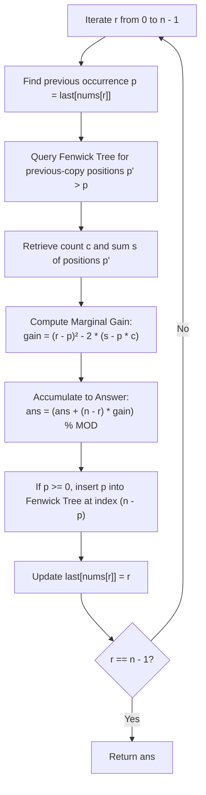

<h2><a href="https://leetcode.com/problems/subarrays-distinct-element-sum-of-squares-ii">2916. Subarrays Distinct Element Sum of Squares II</a></h2>

<p>You are given a <strong>0-indexed </strong>integer array <code>nums</code>.</p>

<p>The <strong>distinct count</strong> of a subarray of <code>nums</code> is defined as:</p>

<ul>
	<li>Let <code>nums[i..j]</code> be a subarray of <code>nums</code> consisting of all the indices from <code>i</code> to <code>j</code> such that <code>0 &lt;= i &lt;= j &lt; nums.length</code>. Then the number of distinct values in <code>nums[i..j]</code> is called the distinct count of <code>nums[i..j]</code>.</li>
</ul>

<p>Return <em>the sum of the <strong>squares</strong> of <strong>distinct counts</strong> of all subarrays of </em><code>nums</code>.</p>

<p>Since the answer may be very large, return it <strong>modulo</strong> <code>10<sup>9</sup> + 7</code>.</p>

<p>A subarray is a contiguous <strong>non-empty</strong> sequence of elements within an array.</p>

<p>&nbsp;</p>
<p><strong>Example 1:</strong></p>

<pre><strong>Input:</strong> nums = [1,2,1]
<strong>Output:</strong> 15
<strong>Explanation:</strong> Six possible subarrays are:
[1]: 1 distinct value
[2]: 1 distinct value
[1]: 1 distinct value
[1,2]: 2 distinct values
[2,1]: 2 distinct values
[1,2,1]: 2 distinct values
The sum of the squares of the distinct counts in all subarrays is equal to 1<sup>2</sup> + 1<sup>2</sup> + 1<sup>2</sup> + 2<sup>2</sup> + 2<sup>2</sup> + 2<sup>2</sup> = 15.
</pre>

<p><strong>Example 2:</strong></p>

<pre><strong>Input:</strong> nums = [2,2]
<strong>Output:</strong> 3
<strong>Explanation:</strong> Three possible subarrays are:
[2]: 1 distinct value
[2]: 1 distinct value
[2,2]: 1 distinct value
The sum of the squares of the distinct counts in all subarrays is equal to 1<sup>2</sup> + 1<sup>2</sup> + 1<sup>2</sup> = 3.</pre>

<p>&nbsp;</p>
<p><strong>Constraints:</strong></p>

<ul>
	<li><code>1 &lt;= nums.length &lt;= 10<sup>5</sup></code></li>
	<li><code>1 &lt;= nums[i] &lt;= 10<sup>5</sup></code></li>
</ul>


---

# 🛍️ Subarrays-Distinct-Element-Sum-of-Squares-II | Explained

## Approach 1: Difference Telescoping & Inverted Fenwick Tree

### Intuition

The canonical way to solve this problem is with a Segment Tree with lazy propagation maintaining range values of $\sum \text{distinct}^2$. However, this solution utilizes a much more elegant mathematical reformulation: **telescoping differences combined with complement counting**.

Imagine you are tracking a score that updates every day. Instead of re-evaluating the total score across all historical intervals every time a new day arrives, you compute only the **marginal gain** $\Delta F(r)$ brought by day $r$. Because this gain will persist for every future day $R \ge r$, its total contribution over all future endpoints is simply $(n - r) \times \Delta F(r)$.

To find the marginal gain $\Delta F(r)$, we observe how the distinct count of subarray $[l, r]$ changes compared to $[l, r - 1]$. The count increases by $1$ only for starting indices $l$ strictly greater than the previous occurrence $p$ of the current number $nums[r]$. Expanding $(x + 1)^2 - x^2 = 2x + 1$ reveals that we need the sum of distinct elements over starting indices $l \in (p, r]$. Instead of counting distinct elements directly, we use **complement counting**: take the total elements in each window minus the number of "duplicates" (elements whose own previous occurrence falls inside $[l, r - 1]$). Reversing the order of summation simplifies this into a query over past indices whose previous occurrences are greater than $p$, which is solved in $O(\log n)$ using a Binary Indexed Tree (Fenwick Tree).

---

### Algorithm Visualized



---

### Approach

1. **Mathematical Reformulation**:
   - Let $F(R) = \sum_{l=0}^R \text{distinct}(l, R)^2$. The total sum required is $\sum_{R=0}^{n-1} F(R)$.
   - Express $F(R)$ as a telescoping sum of marginal gains: $F(R) = \sum_{r=0}^R \Delta F(r)$, where $\Delta F(r) = F(r) - F(r-1)$ and $F(-1) = 0$.
   - Swapping summations gives:
     $$\sum_{R=0}^{n-1} F(R) = \sum_{R=0}^{n-1} \sum_{r=0}^R \Delta F(r) = \sum_{r=0}^{n-1} (n - r) \cdot \Delta F(r)$$
2. **Deriving the Marginal Gain $\Delta F(r)$**:
   - Let $p$ be the previous occurrence index of $nums[r]$ (or $-1$ if none exists).
   - For $l \le p$, $nums[r]$ already appeared in $nums[l..r-1]$, so $\text{distinct}(l, r) = \text{distinct}(l, r-1)$.
   - For $p < l \le r$, $nums[r]$ is new, so $\text{distinct}(l, r) = \text{distinct}(l, r-1) + 1$.
   - The marginal gain is:
     $$\Delta F(r) = \sum_{l=p+1}^r \left[ (\text{distinct}(l, r-1) + 1)^2 - \text{distinct}(l, r-1)^2 \right] = (r - p) + 2 \sum_{l=p+1}^r \text{distinct}(l, r-1)$$
3. **Complement Counting**:
   - For any window $[l, r-1]$, the distinct count equals the length minus duplicate occurrences:
     $$\text{distinct}(l, r-1) = (r - l) - \sum_{r'=l}^{r-1} [p(r') \ge l]$$
   - Summing $(r - l)$ over $l \in [p+1, r]$ yields $\frac{(r - p - 1)(r - p)}{2}$.
   - Substituting back cancels the factor of 2:
     $$\Delta F(r) = (r - p) + (r - p - 1)(r - p) - 2 \sum_{l=p+1}^r \sum_{r'=l}^{r-1} [p(r') \ge l] = (r - p)^2 - 2 \sum_{r' < r, \, p(r') > p} (p(r') - p)$$
4. **Fenwick Tree Query & Update**:
   - We need $c = \sum_{p(r') > p} 1$ and $s = \sum_{p(r') > p} p(r')$.
   - Then $\sum (p(r') - p) = s - p \cdot c$.
   - To query $p' > p$ using standard prefix queries in a Fenwick tree, store indices inverted: map position $p'$ to index $n - p'$. The condition $p' > p \iff p' \ge p + 1 \iff n - p' \le n - p - 1$.
   - A single prefix query up to $n - p - 1$ returns both $c$ and $s$.
   - Finally, insert $p$ at position $n - p$ (if $p = -1$, $n - p = n + 1 > n$, which naturally falls out of bounds and is skipped).

---

### Detailed Code Analysis

#### 1. Data Structures Initialization
```cpp
const long long MOD = 1e9 + 7;
int n = nums.size();
vector<long long> cnt(n + 1), tot(n + 1);  // Fenwick trees over previous-copy positions, stored right to left
unordered_map<int, int> last;
long long ans = 0;
```
- `cnt` and `tot`: Two 1-indexed Fenwick (Binary Indexed) Trees of size $n + 1$. `cnt` tracks the frequency of previous positions $p'$, while `tot` tracks the running sum of those $p'$ values.
- `last`: Maps each element value to its most recent 0-indexed position.

#### 2. Querying Positions Greater Than $p$
```cpp
for (int r = 0; r < n; r++) {
    int p = last.count(nums[r]) ? last[nums[r]] : -1;
    long long c = 0, s = 0;
    for (int i = n - p - 1; i > 0; i -= i & -i)  // boxes 1..n-p-1 hold the positions > p
        c += cnt[i], s += tot[i];
```
- If $nums[r]$ has not been seen, $p = -1$.
- To find all past entries $r' < r$ where $p(r') > p$, we translate $p' > p$ to $n - p' \le n - p - 1$.
- The loop standardly decrements $i$ using `i -= i & -i` to calculate prefix sums of `cnt` and `tot` up to index $n - p - 1$.

#### 3. Calculating Gain and Accumulating to Total Answer
```cpp
    long long gain = (long long)(r - p) * (r - p) - 2 * (s - p * c);  // at most 1e10
    ans = (ans + (n - r) * gain) % MOD;
```
- `gain` is computed as $(r - p)^2 - 2(s - p \cdot c)$ exactly matching $\Delta F(r)$. Because $r - p \le 10^5$, $(r - p)^2 \le 10^{10}$, which safely fits inside a 64-bit signed integer (`long long`).
- $(n - r)$ is the number of right endpoints $R \in [r, n-1]$ that contain index $r$. Multiplying `gain` by $(n - r)$ accounts for the marginal contribution of $nums[r]$ to all covering subarrays in one step.

#### 4. Updating the Fenwick Tree and Hash Map
```cpp
    for (int i = n - p; i <= n; i += i & -i)  // insert p; p = -1 lands past the end and is skipped
        cnt[i]++, tot[i] += p;
    last[nums[r]] = r;
}
return ans;
```
- We now insert the previous position $p$ into the Fenwick Tree at index $n - p$.
- If $p = -1$, $i = n - (-1) = n + 1$. Because the loop condition is $i \le n$, the update is skipped automatically without needing an extra `if (p >= 0)` branch.
- Finally, update `last[nums[r]] = r` to prepare for subsequent occurrences of `nums[r]`.

---

### Code

```cpp
class Solution {
public:
    int sumCounts(vector<int>& nums) {
        const long long MOD = 1e9 + 7;
        int n = nums.size();
        vector<long long> cnt(n + 1), tot(n + 1);  // Fenwick trees over previous-copy positions, stored right to left
        unordered_map<int, int> last;
        long long ans = 0;
        
        for (int r = 0; r < n; r++) {
            int p = last.count(nums[r]) ? last[nums[r]] : -1;
            long long c = 0, s = 0;
            for (int i = n - p - 1; i > 0; i -= i & -i)  // boxes 1..n-p-1 hold the positions > p
                c += cnt[i], s += tot[i];
            
            long long gain = (long long)(r - p) * (r - p) - 2 * (s - p * c);  // at most 1e10
            ans = (ans + (n - r) * gain) % MOD;
            
            for (int i = n - p; i <= n; i += i & -i)  // insert p; p = -1 lands past the end and is skipped
                cnt[i]++, tot[i] += p;
            
            last[nums[r]] = r;
        }
        
        return ans;
    }
};
```

---

### Complexity

- **Time Complexity:** $\mathcal{O}(n \log n)$
  - The loop runs $n$ times.
  - In each iteration, querying the Fenwick tree takes $\mathcal{O}(\log n)$ time, and updating it takes $\mathcal{O}(\log n)$ time.
  - Hash map operations take $\mathcal{O}(1)$ average time.
  - Overall Time Complexity: $\mathcal{O}(n \log n)$. This is significantly faster in runtime and has a far smaller constant factor than the $\mathcal{O}(n \log n)$ Segment Tree with lazy propagation.

- **Space Complexity:** $\mathcal{O}(n)$
  - Two Fenwick trees `cnt` and `tot` of size $n + 1$ require $\mathcal{O}(n)$ auxiliary space.
  - The `last` hash map stores at most $\min(n, |\Sigma|)$ elements, which is $\mathcal{O}(n)$.
  - Total Space Complexity: $\mathcal{O}(n)$.

---

## 🕵️‍♂️ Follow-up Questions

### 1. How does this compare to the standard Segment Tree with Lazy Propagation approach?
The standard segment tree maintains an array $A[l] = \text{distinct}(l, r)$ as $r$ advances. At each step, elements in range $(p, r]$ are incremented by $1$. Because $(x + 1)^2 = x^2 + 2x + 1$, the tree must maintain both $\sum x^2$ and $\sum x$ alongside range addition lazy tags.
While both approaches achieve $\mathcal{O}(n \log n)$ time complexity, the Fenwick tree approach reduces the constant factor by roughly $4\times$ to $8\times$, requires only two flat 1D vectors rather than a 4-node-per-element tree, and avoids all pointer/lazy tag push-down logic entirely.

### 2. Can the hash map overhead be eliminated?
Yes. If the elements in `nums` are within a bounded range $[1, 10^5]$ (as is common in LeetCode problems), `last` can be replaced with a flat `vector<int> last(MAX_VAL + 1, -1)`. If elements are unbounded, an initial coordinate compression pass in $\mathcal{O}(n \log n)$ enables using a flat array of size $n$, removing hash collisions and dynamic allocations for optimal cache locality.