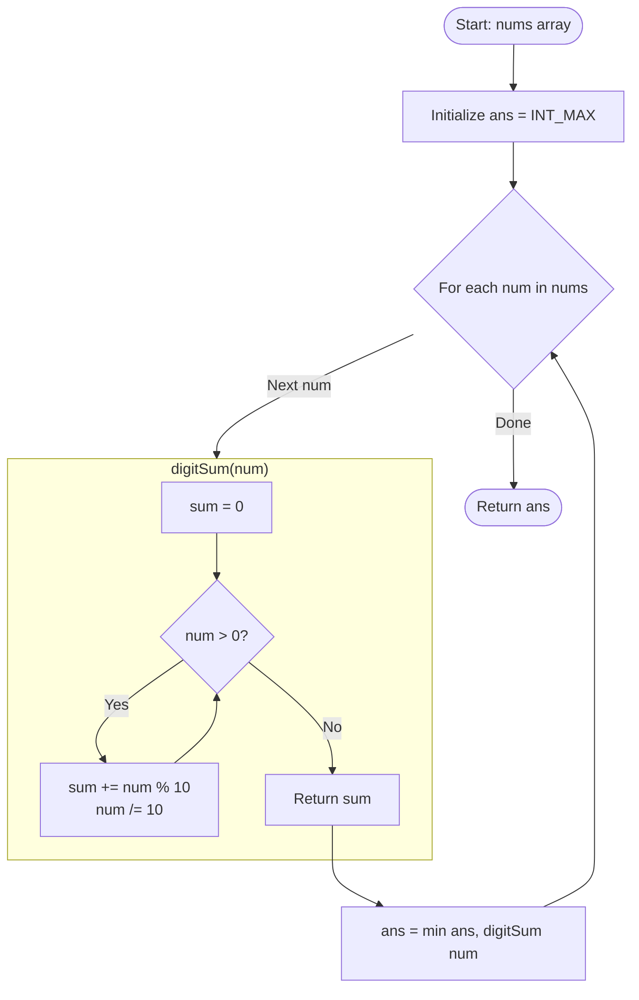

<h2><a href="https://leetcode.com/problems/minimum-element-after-replacement-with-digit-sum">3300. Minimum Element After Replacement With Digit Sum</a></h2>

<p>You are given an integer array <code>nums</code>.</p>

<p>You replace each element in <code>nums</code> with the <strong>sum</strong> of its digits.</p>

<p>Return the <strong>minimum</strong> element in <code>nums</code> after all replacements.</p>

<p>&nbsp;</p>
<p><strong class="example">Example 1:</strong></p>

<div class="example-block">
<p><strong>Input:</strong> <span class="example-io">nums = [10,12,13,14]</span></p>

<p><strong>Output:</strong> <span class="example-io">1</span></p>

<p><strong>Explanation:</strong></p>

<p><code>nums</code> becomes <code>[1, 3, 4, 5]</code> after all replacements, with minimum element 1.</p>
</div>

<p><strong class="example">Example 2:</strong></p>

<div class="example-block">
<p><strong>Input:</strong> <span class="example-io">nums = [1,2,3,4]</span></p>

<p><strong>Output:</strong> <span class="example-io">1</span></p>

<p><strong>Explanation:</strong></p>

<p><code>nums</code> becomes <code>[1, 2, 3, 4]</code> after all replacements, with minimum element 1.</p>
</div>

<p><strong class="example">Example 3:</strong></p>

<div class="example-block">
<p><strong>Input:</strong> <span class="example-io">nums = [999,19,199]</span></p>

<p><strong>Output:</strong> <span class="example-io">10</span></p>

<p><strong>Explanation:</strong></p>

<p><code>nums</code> becomes <code>[27, 10, 19]</code> after all replacements, with minimum element 10.</p>
</div>

<p>&nbsp;</p>
<p><strong>Constraints:</strong></p>

<ul>
	<li><code>1 &lt;= nums.length &lt;= 100</code></li>
	<li><code>1 &lt;= nums[i] &lt;= 10<sup>4</sup></code></li>
</ul>


---

# 🛍️ Minimum-Element-After-Replacement-With-Digit-Sum | Explained

## Approach 1: Single-Pass Scan with On-the-Fly Digit Sum Transformation

### Intuition
Imagine you are a judge at an audition where every contestant carries a jar full of change. Your goal is to find the person with the smallest total dollar amount. Instead of dumping every jar onto a giant table at the same time to create a brand-new list of totals (which consumes extra table space), you can evaluate each contestant one by one. You empty contestant A's jar coin-by-coin, tally their sum, note if it's the lowest seen so far, and then move on to contestant B. 

In this problem, replacing each element with its digit sum doesn't require mutating the original array or allocating a new one. By computing the digit sum of each number on the fly and continuously updating a running minimum, you achieve optimal space and time efficiency in a single iteration.

### Algorithm Visualized



### Approach
1. **Helper Function (`digitSum`)**:
   - Accepts an integer `num`.
   - Repeatedly extracts the least significant digit using the modulo operator (`num % 10`).
   - Adds this digit to a running accumulator `sum`.
   - Strips off the least significant digit by performing integer division (`num /= 10`).
   - Terminates when `num` becomes `0` and returns `sum`.

2. **Main Function (`minElement`)**:
   - Initialize a variable `ans` to `INT_MAX` (the largest possible 32-bit signed integer) to ensure any valid digit sum will be smaller than the initial state.
   - Iterate through each integer `num` in the input array `nums`.
   - For each element, compute its digit sum using `digitSum(num)` and update `ans` via `min(ans, ...)`.
   - Once the iteration is complete, return `ans`.

### Detailed Code Analysis

```cpp
class Solution {
public:
    int digitSum(int num) {
        int sum = 0;
        while (num > 0) {
            sum += num % 10;
            num /= 10;
        }
        return sum;
    }
```
- **Lines 3–4**: `int digitSum(int num)` takes `num` by value, ensuring that mutating `num` within this scope does not alter the caller's copy. `int sum = 0;` initializes the digit accumulator.
- **Lines 5–8**: The `while (num > 0)` loop handles the base-10 digit extraction:
  - `num % 10` isolates the rightmost digit (e.g., $432 \pmod{10} = 2$).
  - `sum += num % 10` adds this digit to our running total.
  - `num /= 10` shifts the number one decimal place to the right, truncating the fractional part (e.g., $432 / 10 = 43$).
- **Line 9**: Returns the fully computed digit sum.

```cpp
    int minElement(vector<int>& nums) {
        int ans = INT_MAX;
        for (int num : nums) {
            ans = min(ans, digitSum(num));
        }
        return ans;
    }
};
```
- **Line 11**: `minElement(vector<int>& nums)` receives `nums` by constant or mutable reference (`vector<int>&`), avoiding an expensive copy of the vector.
- **Line 12**: `int ans = INT_MAX;` establishes the identity element for the `min` operation.
- **Lines 13–15**: A C++ range-based `for` loop (`for (int num : nums)`) traverses each element sequentially. In each iteration, `digitSum(num)` is evaluated and `std::min` checks if this new sum is smaller than `ans`. If so, `ans` is updated.
- **Line 16**: Returns the minimum value discovered across all transformed elements.

### Code
```cpp
class Solution {
public:
    int digitSum(int num) {
        int sum = 0;
        while (num > 0) {
            sum += num % 10;
            num /= 10;
        }
        return sum;
    }

    int minElement(vector<int>& nums) {
        int ans = INT_MAX;
        for (int num : nums) {
            ans = min(ans, digitSum(num));
        }
        return ans;
    }
};
```

### Complexity
- **Time Complexity:** $\mathcal{O}(N \cdot \log_{10}(M))$
  - Let $N$ be the number of elements in `nums` and $M$ be the maximum value of an element in `nums`.
  - For each of the $N$ numbers, the `while` loop runs $\lfloor \log_{10}(\text{num}) \rfloor + 1$ times.
  - In typical LeetCode constraints where `nums[i] <= 10^4`, the loop executes at most $5$ times per number, rendering the inner operation effectively $\mathcal{O}(1)$ and overall execution time strictly linear: $\mathcal{O}(N)$.
- **Space Complexity:** $\mathcal{O}(1)$ auxiliary space
  - The solution works in-place conceptually without allocating new arrays, hash maps, or recursion call stacks. Only a few primitive scalar variables (`sum`, `num`, `ans`) are allocated in registers/stack memory.

---

## 🕵️‍♂️ Follow-up Questions (Optional)

1. **Can we optimize this with an early-exit condition?**
   - *Answer:* Yes. Since `nums[i] >= 1`, the absolute minimum possible sum of digits for any positive integer is `1` (achieved by numbers like $1, 10, 100, \dots$). If at any point `ans == 1`, we can immediately `break` or `return 1`, avoiding unnecessary computations for the remainder of the array.

2. **How would this behave if negative numbers were permitted in `nums`?**
   - *Answer:* The standard `%` operator in C++ retains the sign of the dividend (e.g., `-12 % 10 == -2`). If negative numbers were included, the problem would need to define whether the sign applies to the whole sum or only the most significant digit. To compute the sum of absolute digits, you would take `num = std::abs(num)` prior to the extraction loop.