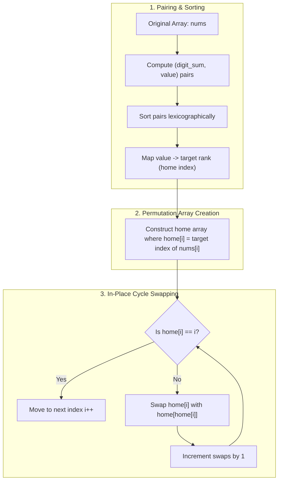

<h2><a href="https://leetcode.com/problems/minimum-swaps-to-sort-by-digit-sum">3551. Minimum Swaps to Sort by Digit Sum</a></h2>

<p>You are given an array <code>nums</code> of <strong>distinct</strong> positive integers. You need to sort the array in <strong>increasing</strong> order based on the sum of the digits of each number. If two numbers have the same digit sum, the <strong>smaller</strong> number appears first in the sorted order.</p>

<p>Return the <strong>minimum</strong> number of swaps required to rearrange <code>nums</code> into this sorted order.</p>

<p>A <strong>swap</strong> is defined as exchanging the values at two distinct positions in the array.</p>

<p>&nbsp;</p>
<p><strong class="example">Example 1:</strong></p>

<div class="example-block">
<p><strong>Input:</strong> <span class="example-io">nums = [37,100]</span></p>

<p><strong>Output:</strong> <span class="example-io">1</span></p>

<p><strong>Explanation:</strong></p>

<ul>
	<li>Compute the digit sum for each integer: <code>[3 + 7 = 10, 1 + 0 + 0 = 1] → [10, 1]</code></li>
	<li>Sort the integers based on digit sum: <code>[100, 37]</code>. Swap <code>37</code> with <code>100</code> to obtain the sorted order.</li>
	<li>Thus, the minimum number of swaps required to rearrange <code>nums</code> is 1.</li>
</ul>
</div>

<p><strong class="example">Example 2:</strong></p>

<div class="example-block">
<p><strong>Input:</strong> <span class="example-io">nums = [22,14,33,7]</span></p>

<p><strong>Output:</strong> <span class="example-io">0</span></p>

<p><strong>Explanation:</strong></p>

<ul>
	<li>Compute the digit sum for each integer: <code>[2 + 2 = 4, 1 + 4 = 5, 3 + 3 = 6, 7 = 7] → [4, 5, 6, 7]</code></li>
	<li>Sort the integers based on digit sum: <code>[22, 14, 33, 7]</code>. The array is already sorted.</li>
	<li>Thus, the minimum number of swaps required to rearrange <code>nums</code> is 0.</li>
</ul>
</div>

<p><strong class="example">Example 3:</strong></p>

<div class="example-block">
<p><strong>Input:</strong> <span class="example-io">nums = [18,43,34,16]</span></p>

<p><strong>Output:</strong> <span class="example-io">2</span></p>

<p><strong>Explanation:</strong></p>

<ul>
	<li>Compute the digit sum for each integer: <code>[1 + 8 = 9, 4 + 3 = 7, 3 + 4 = 7, 1 + 6 = 7] → [9, 7, 7, 7]</code></li>
	<li>Sort the integers based on digit sum: <code>[16, 34, 43, 18]</code>. Swap <code>18</code> with <code>16</code>, and swap <code>43</code> with <code>34</code> to obtain the sorted order.</li>
	<li>Thus, the minimum number of swaps required to rearrange <code>nums</code> is 2.</li>
</ul>
</div>

<p>&nbsp;</p>
<p><strong>Constraints:</strong></p>

<ul>
	<li><code>1 &lt;= nums.length &lt;= 10<sup>5</sup></code></li>
	<li><code>1 &lt;= nums[i] &lt;= 10<sup>9</sup></code></li>
	<li><code>nums</code> consists of <strong>distinct</strong> positive integers.</li>
</ul>


---

# 🛍️ Minimum-Swaps-to-Sort-by-Digit-Sum | Explained

## Approach 1: Coordinate Compression and Cycle Decomposition
### Intuition
Imagine a classroom of students standing in a line, each assigned a specific assigned seat in an auditorium. To seat everyone correctly with the minimum number of seat exchanges, you can inspect each student: if student $A$ is currently standing at spot $i$ but belongs in seat $j$, you swap student $A$ with whoever is currently sitting in seat $j$. Now student $A$ is in their correct seat, and you repeat this process with the newcomer at spot $i$ until whoever is standing at spot $i$ actually belongs at spot $i$. 

This problem reduces to two distinct phases:
1. **Determine Target Coordinates:** Define the target order by sorting pairs of `(digit_sum, value)`. Because the sorted order specifies where each number must end up, we assign each original value a target rank (its "home" index).
2. **Cycle Decomposition:** Any permutation can be decomposed into disjoint directed cycles. If a cycle contains $L$ elements, putting all $L$ elements into their respective target positions requires exactly $L - 1$ swaps. Repeatedly placing misplaced elements directly into their target index resolves each cycle greedily in minimum swaps.

### Algorithm Visualized



---

### Approach
1. **Digit Sum Calculation:** Define a helper function to sum the base-10 digits of an integer $x$.
2. **Pairing and Lexicographical Sort:** Pair each element $x$ with its digit sum as `(digit_sum(x), x)`. By sorting these pairs, C++'s `std::ranges::sort` naturally breaks ties in digit sums using the number's actual numerical value.
3. **Rank Mapping:** Store the target index of each sorted number in a hash table (`rank`), where the key is the number itself and the value is its 0-indexed sorted position.
4. **Construct Target Indices Array:** Transform the original array into an array `home`, where `home[i]` denotes the destination index where the element at position `i` must relocate.
5. **Permutation Cycle Traversal:** Iterate through each position $i$ from $0$ to $n - 1$. While `home[i] != i`, swap the element at index $i$ with the element at index `home[i]`. Each swap places at least one element into its final sorted position and increments the swap counter.

---

### Detailed Code Analysis

```cpp
auto digit_sum = [](int x) {
    int s = 0;
    for (; x > 0; x /= 10) s += x % 10;
    return s;
};
```
- A lambda function `digit_sum` extracts digits using standard modulo arithmetic (`x % 10`) and division (`x /= 10`), running in $O(\log_{10}(x))$ time per number.

```cpp
int n = nums.size();
vector<pair<int, int>> keyed;  // (digit sum, value)
for (int x : nums) keyed.emplace_back(digit_sum(x), x);
ranges::sort(keyed);
```
- A vector of pairs `keyed` is populated with `(digit_sum(x), x)`. 
- `ranges::sort(keyed)` performs an introspective sort ($O(n \log n)$ comparisons). Since `std::pair` compares the `first` element (digit sum) first, and falls back to the `second` element (original integer value) upon ties, this achieves the required ordering rule.

```cpp
unordered_map<int, int> rank;  // final position of each value
for (int k = 0; k < n; k++) rank[keyed[k].second] = k;
vector<int> home;  // where the value at each position must go
for (int x : nums) home.push_back(rank[x]);
```
- An `unordered_map<int, int>` records each number's intended destination index `k`.
- The `home` vector represents the permutation $\pi$ where $\pi[i]$ is the index in the sorted array where the current number at `nums[i]` needs to land.

```cpp
int swaps = 0;
for (int i = 0; i < n; i++) {
    while (home[i] != i) {  // send the value at i home, take that spot's value in exchange
        int j = home[i];
        swap(home[i], home[j]);
        swaps++;
    }
}
return swaps;
```
- The outer loop steps through each index $i$.
- If `home[i] == i`, the element is already in its correct location (a cycle of length 1).
- If `home[i] != i`, it belongs to a cycle of length $L > 1$. By setting `j = home[i]` and swapping `home[i]` with `home[j]`, the element originally at $i$ reaches its final position $j$. The element previously at $j$ is brought to $i$ to be resolved in subsequent iterations of the `while` loop.
- Because every swap places at least one element into its permanent position (`home[j] == j`), the inner loop runs at most $n$ times total across the entire execution.

---

### Code
```cpp
class Solution {
public:
    int minSwaps(vector<int>& nums) {
        auto digit_sum = [](int x) {
            int s = 0;
            for (; x > 0; x /= 10) s += x % 10;
            return s;
        };
        int n = nums.size();
        vector<pair<int, int>> keyed;  // (digit sum, value)
        for (int x : nums) keyed.emplace_back(digit_sum(x), x);
        ranges::sort(keyed);
        unordered_map<int, int> rank;  // final position of each value
        for (int k = 0; k < n; k++) rank[keyed[k].second] = k;
        vector<int> home;  // where the value at each position must go
        for (int x : nums) home.push_back(rank[x]);

        int swaps = 0;
        for (int i = 0; i < n; i++) {
            while (home[i] != i) {  // send the value at i home, take that spot's value in exchange
                int j = home[i];
                swap(home[i], home[j]);
                swaps++;
            }
        }
        return swaps;
    }
};
```

---

### Complexity
- **Time:** $O(n \log n + n \log_{10}(M))$ where $n$ is the number of elements in `nums` and $M$ is the maximum value in `nums`.
  - Computing the digit sums takes $O(n \log_{10}(M))$ operations.
  - Sorting the `keyed` vector takes $O(n \log n)$.
  - Populating the hash map and building `home` takes $O(n)$ average time.
  - The cycle-swapping while loop executes at most $n - 1$ swaps across all iterations because each swap permanently resolves one element's position. Thus, cycle decomposition takes $O(n)$ time.
- **Space:** $O(n)$ auxiliary space.
  - `keyed` vector stores $n$ pairs ($O(n)$ space).
  - `rank` hash map stores $n$ key-value pairs ($O(n)$ space).
  - `home` array stores $n$ integers ($O(n)$ space).

---

## 🕵️‍♂️ Follow-up Questions (Optional)

1. **How can you optimize auxiliary space to avoid using an `unordered_map`?**
   - Instead of storing pairs of `(digit_sum, value)` and then mapping values back through an `unordered_map`, store triplets or a custom struct: `(digit_sum, value, original_index)`. After sorting, the element at sorted position `k` originated at `original_index`. We can directly populate `home[original_index] = k` in $O(n)$ without hash table lookups or overhead, eliminating hash collisions and duplicate-value issues entirely.

2. **What happens if `nums` contains duplicate values?**
   - The current `unordered_map<int, int> rank` will overwrite earlier occurrences when identical numbers exist, causing invalid index assignments. By keeping track of each element's unique original index `i` during the sort (e.g., sorting tuples of `(digit_sum, value, original_index)`), duplicates are differentiated by their unique indices, keeping the cycle decomposition mathematically sound.