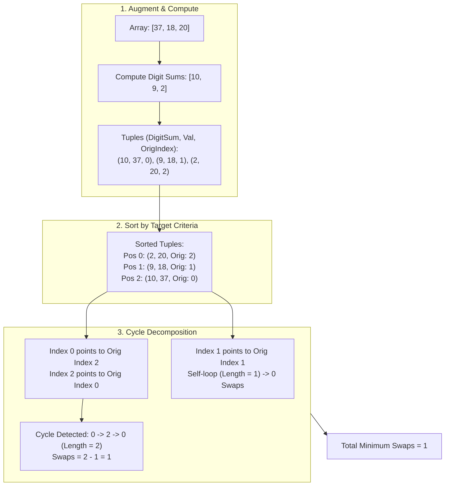

<h2><a href="https://leetcode.com/problems/minimum-swaps-to-sort-by-digit-sum">3551. Minimum Swaps to Sort by Digit Sum</a></h2>

<p>You are given an array <code>nums</code> of <strong>distinct</strong> positive integers. You need to sort the array in <strong>increasing</strong> order based on the sum of the digits of each number. If two numbers have the same digit sum, the <strong>smaller</strong> number appears first in the sorted order.</p>

<p>Return the <strong>minimum</strong> number of swaps required to rearrange <code>nums</code> into this sorted order.</p>

<p>A <strong>swap</strong> is defined as exchanging the values at two distinct positions in the array.</p>

<p>&nbsp;</p>
<p><strong class="example">Example 1:</strong></p>

<div class="example-block">
<p><strong>Input:</strong> <span class="example-io">nums = [37,100]</span></p>

<p><strong>Output:</strong> <span class="example-io">1</span></p>

<p><strong>Explanation:</strong></p>

<ul>
	<li>Compute the digit sum for each integer: <code>[3 + 7 = 10, 1 + 0 + 0 = 1] → [10, 1]</code></li>
	<li>Sort the integers based on digit sum: <code>[100, 37]</code>. Swap <code>37</code> with <code>100</code> to obtain the sorted order.</li>
	<li>Thus, the minimum number of swaps required to rearrange <code>nums</code> is 1.</li>
</ul>
</div>

<p><strong class="example">Example 2:</strong></p>

<div class="example-block">
<p><strong>Input:</strong> <span class="example-io">nums = [22,14,33,7]</span></p>

<p><strong>Output:</strong> <span class="example-io">0</span></p>

<p><strong>Explanation:</strong></p>

<ul>
	<li>Compute the digit sum for each integer: <code>[2 + 2 = 4, 1 + 4 = 5, 3 + 3 = 6, 7 = 7] → [4, 5, 6, 7]</code></li>
	<li>Sort the integers based on digit sum: <code>[22, 14, 33, 7]</code>. The array is already sorted.</li>
	<li>Thus, the minimum number of swaps required to rearrange <code>nums</code> is 0.</li>
</ul>
</div>

<p><strong class="example">Example 3:</strong></p>

<div class="example-block">
<p><strong>Input:</strong> <span class="example-io">nums = [18,43,34,16]</span></p>

<p><strong>Output:</strong> <span class="example-io">2</span></p>

<p><strong>Explanation:</strong></p>

<ul>
	<li>Compute the digit sum for each integer: <code>[1 + 8 = 9, 4 + 3 = 7, 3 + 4 = 7, 1 + 6 = 7] → [9, 7, 7, 7]</code></li>
	<li>Sort the integers based on digit sum: <code>[16, 34, 43, 18]</code>. Swap <code>18</code> with <code>16</code>, and swap <code>43</code> with <code>34</code> to obtain the sorted order.</li>
	<li>Thus, the minimum number of swaps required to rearrange <code>nums</code> is 2.</li>
</ul>
</div>

<p>&nbsp;</p>
<p><strong>Constraints:</strong></p>

<ul>
	<li><code>1 &lt;= nums.length &lt;= 10<sup>5</sup></code></li>
	<li><code>1 &lt;= nums[i] &lt;= 10<sup>9</sup></code></li>
	<li><code>nums</code> consists of <strong>distinct</strong> positive integers.</li>
</ul>


---

# 🛍️ Minimum-Swaps-to-Sort-by-Digit-Sum | Explained

## Approach 1: Cycle Decomposition via Custom Coordinate Sorting

### Intuition
Think of this problem like an assigned seating arrangement at a banquet. Initially, guests (the numbers) are sitting in arbitrary chairs (indices $0$ to $n-1$). Based on a custom protocol—first by their digit sum, and if tied, by their actual value—each guest has a specific assigned seat. 

If guest $A$ is sitting in guest $B$'s assigned seat, guest $B$ is sitting in guest $C$'s assigned seat, and guest $C$ is sitting in guest $A$'s assigned seat, they form a closed "cycle" of displaced individuals. To place all 3 guests into their proper seats using only pairwise swaps, it always takes exactly $3 - 1 = 2$ swaps. If a guest is already in their correct seat, they form a cycle of length 1, requiring $1 - 1 = 0$ swaps. 

Because any permutation of distinct positions can be decomposed into a set of disjoint directed cycles, the minimum total number of swaps required to sort the array is the sum of $(L - 1)$ for every cycle of length $L$.

### Algorithm Visualized



### Approach
1. **Data Augmentation**:
   - For each number in `nums`, calculate its digit sum.
   - Store the elements as a triplet: `(digit_sum, value, original_index)`. Storing the original index is critical because it tells us where the item came from in the unsorted array.
2. **Stable Sorting by Custom Rule**:
   - Sort the triplets primarily by `digit_sum` ascending.
   - If two elements have equal digit sums, break ties by comparing their original numeric `value` ascending.
3. **Graph Modeling (Cycle Decomposition)**:
   - After sorting, the triplet at index `i` contains `a[i][2]`, which indicates the index where this element originally resided.
   - This forms a directed permutation graph where a directed edge exists from index `i` to index `a[i][2]`.
   - Maintain a boolean array `vis` to avoid recounting elements in already processed cycles.
4. **Counting Minimum Swaps**:
   - Iterate from $i = 0$ to $n - 1$.
   - If position $i$ is already visited or already in its correct spot (`a[i][2] == i`), skip it.
   - Otherwise, traverse the cycle starting at $i$, marking all nodes in the cycle as visited, and count the cycle length `len`.
   - Add `len - 1` to the total swap count.

### Detailed Code Analysis

#### 1. Augmenting Data with Digit Sums and Original Indices
```java
int n = nums.length;
int[][] a = new int[n][3];
for (int i = 0; i < n; i++) {
    int s = 0, x = nums[i];
    while (x > 0) {
        s += x % 10;
        x /= 10;
    }
    a[i][0] = s;
    a[i][1] = nums[i];
    a[i][2] = i;
}
```
- `a` is allocated as an $n \times 3$ matrix.
  - `a[i][0]`: Sum of the digits of `nums[i]`.
  - `a[i][1]`: Original value `nums[i]`.
  - `a[i][2]`: Original index `i`.
- The inner `while` loop extracts digits using the modulo operator (`x % 10`) and strips them with integer division (`x /= 10`).

#### 2. Custom Dual-Criterion Sorting
```java
Arrays.sort(a, (p, q) -> p[0] != q[0]
        ? Integer.compare(p[0], q[0])
        : Integer.compare(p[1], q[1]));
```
- Sorts array `a` using a lambda comparator.
- Checks if the digit sums `p[0]` and `q[0]` differ:
  - If different, orders by `p[0] - q[0]`.
  - If identical, breaks ties using their actual numeric values `p[1]` and `q[1]`.
- Post-sort, index `i` represents where an element *must end up*, and `a[i][2]` represents where it *currently resides*.

#### 3. Permutation Cycle Traversal
```java
boolean[] vis = new boolean[n];
int swaps = 0;
for (int i = 0; i < n; i++) {
    if (vis[i] || a[i][2] == i) continue;
    int j = i, len = 0;
    while (!vis[j]) {
        vis[j] = true;
        j = a[j][2];
        len++;
    }
    swaps += len - 1;
}
return swaps;
```
- `vis` array prevents infinite loops and ensures each cycle is resolved exactly once.
- `if (vis[i] || a[i][2] == i) continue;`: Skips elements that are either already accounted for or already resting in their correct sorted location.
- Inside the `while (!vis[j])` loop:
  - Traverses the cycle by jumping from current position `j` to `a[j][2]`.
  - Marks `j` as visited and increments `len`.
- For each cycle of length `len`, the minimum swaps required to resolve it is `len - 1`. Accumulating these gives the minimal global swaps.

### Code
```java
class Solution {
    public int minSwaps(int[] nums) {
        int n = nums.length;
        int[][] a = new int[n][3];
        for (int i = 0; i < n; i++) {
            int s = 0, x = nums[i];
            while (x > 0) {
                s += x % 10;
                x /= 10;
            }
            a[i][0] = s;
            a[i][1] = nums[i];
            a[i][2] = i;
        }
        Arrays.sort(a, (p, q) -> p[0] != q[0]
                ? Integer.compare(p[0], q[0])
                : Integer.compare(p[1], q[1]));

        boolean[] vis = new boolean[n];
        int swaps = 0;
        for (int i = 0; i < n; i++) {
            if (vis[i] || a[i][2] == i) continue;
            int j = i, len = 0;
            while (!vis[j]) {
                vis[j] = true;
                j = a[j][2];
                len++;
            }
            swaps += len - 1;
        }
        return swaps;
    }
}
```

### Complexity
- **Time:** $\mathcal{O}(N \log N + N \log_{10} M)$, where $N$ is the number of elements in `nums` and $M$ is the maximum value in `nums`.
  - Calculating the digit sums takes $\mathcal{O}(N \log_{10} M)$ operations since each number has at most $\approx \log_{10}(M)$ digits.
  - Sorting the array `a` of size $N$ takes $\mathcal{O}(N \log N)$ comparisons.
  - The cycle detection visits each index at most twice across the outer loop and the `while` traversal, running in $\mathcal{O}(N)$ time.
  - Dominated by sorting: $\mathcal{O}(N \log N)$.
- **Space:** $\mathcal{O}(N)$ auxiliary space.
  - Array `a` requires $\mathcal{O}(N)$ space to store $N \times 3$ integers.
  - Boolean array `vis` requires $\mathcal{O}(N)$ space.
  - Sorting recursion stack overhead takes $\mathcal{O}(\log N)$.

---

## 🕵️‍♂️ Follow-up Questions (Optional)

1. **How can you optimize space if creating an auxiliary 2D array is too expensive in memory-constrained environments?**
   - Instead of allocating an $N \times 3$ matrix `a`, pack the original index into an `Integer[] idx` array initialized with values $0$ to $n-1$.
   - Precompute digit sums in a 1D primitive array `int[] digitSums`.
   - Sort `idx` based on `digitSums[idx[i]]` and `nums[idx[i]]`. This avoids boxing integers or creating multi-dimensional array object overheads in Java.

2. **Can we solve this problem in $\mathcal{O}(N)$ time if numbers are bounded?**
   - Yes. If the maximum value of $nums[i]$ is bounded (e.g., $nums[i] \le 10^6$), the maximum digit sum is bounded (at most $9 \times 6 = 54$).
   - We can sort using **Radix Sort** or **Counting Sort** in $\mathcal{O}(N)$ time instead of comparison sort $\mathcal{O}(N \log N)$. Once the sorted positions are known, the cycle traversal still runs in $\mathcal{O}(N)$ time, achieving an overall $\mathcal{O}(N)$ linear time complexity.