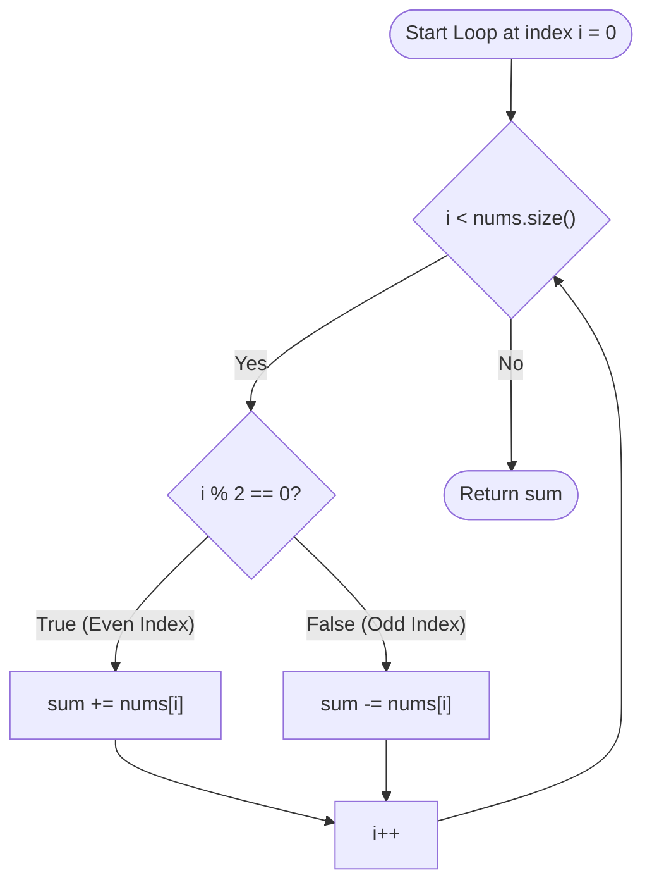

<h2><a href="https://leetcode.com/problems/compute-alternating-sum">3701. Compute Alternating Sum</a></h2>

<p>You are given an integer array <code>nums</code>.</p>

<p>The <strong>alternating sum</strong> of <code>nums</code> is the value obtained by <strong>adding</strong> elements at even indices and <strong>subtracting</strong> elements at odd indices. That is, <code>nums[0] - nums[1] + nums[2] - nums[3]...</code></p>

<p>Return an integer denoting the alternating sum of <code>nums</code>.</p>

<p>&nbsp;</p>
<p><strong class="example">Example 1:</strong></p>

<div class="example-block">
<p><strong>Input:</strong> <span class="example-io">nums = [1,3,5,7]</span></p>

<p><strong>Output:</strong> <span class="example-io">-4</span></p>

<p><strong>Explanation:</strong></p>

<ul>
	<li>Elements at even indices are <code>nums[0] = 1</code> and <code>nums[2] = 5</code> because 0 and 2 are even numbers.</li>
	<li>Elements at odd indices are <code>nums[1] = 3</code> and <code>nums[3] = 7</code> because 1 and 3 are odd numbers.</li>
	<li>The alternating sum is <code>nums[0] - nums[1] + nums[2] - nums[3] = 1 - 3 + 5 - 7 = -4</code>.</li>
</ul>
</div>

<p><strong class="example">Example 2:</strong></p>

<div class="example-block">
<p><strong>Input:</strong> <span class="example-io">nums = [100]</span></p>

<p><strong>Output:</strong> <span class="example-io">100</span></p>

<p><strong>Explanation:</strong></p>

<ul>
	<li>The only element at even indices is <code>nums[0] = 100</code> because 0 is an even number.</li>
	<li>There are no elements on odd indices.</li>
	<li>The alternating sum is <code>nums[0] = 100</code>.</li>
</ul>
</div>

<p>&nbsp;</p>
<p><strong>Constraints:</strong></p>

<ul>
	<li><code>1 &lt;= nums.length &lt;= 100</code></li>
	<li><code>1 &lt;= nums[i] &lt;= 100</code></li>
</ul>


---

# 🛍️ Compute-Alternating-Sum | Explained

## Approach 1: Single-Pass Iteration with Parity Check
### Intuition
Think of an alternating sum like a turn-based board game where two players take turns modifying a single shared score. Player 1 (representing even indices) adds points to the score on their turn, while Player 2 (representing odd indices) subtracts points on their turn. 

Because the operations strictly alternate based on the index position ($0, 1, 2, 3, \dots$), you can determine whether an element should be added or subtracted purely by checking if the current index is divisible by $2$. Walking through the array from left to right allows you to compute the net balance in a single continuous sweep.

### Algorithm Visualized


### Approach
1. **Initialize an Accumulator**: Create an integer variable `sum` initialized to `0` to keep track of the running total.
2. **Linear Traversal**: Iterate through the input vector `nums` using an index variable `i` running from `0` to `nums.size() - 1`.
3. **Parity Branching**:
   - Compute `i % 2`. If the remainder is `0` (the index is even), add `nums[i]` to `sum`.
   - If the remainder is non-zero (the index is odd), subtract `nums[i]` from `sum`.
4. **Return Final Balance**: Once the loop terminates after processing all elements, return the accumulated `sum`.

### Detailed Code Analysis
- **Line 4 (`int sum=0;`)**: Allocates a 32-bit signed integer `sum` initialized to `0`. This acts as our accumulator across the traversal.
- **Line 5 (`for(int i=0; i<nums.size(); i++)`)**: A standard bounded `for` loop. `nums.size()` returns the total number of elements. The loop index `i` increments by `1` in each iteration, visiting every index from `0` to `nums.size() - 1` exactly once.
- **Lines 6–8 (`if(i%2==0) { sum+=nums[i]; }`)**: The modulo operator `%` calculates the remainder of `i` divided by `2`. When `i` is even (`0, 2, 4, ...`), `i % 2 == 0` evaluates to `true`, and the value at `nums[i]` is added to `sum`.
- **Lines 9–10 (`else sum-=nums[i];`)**: When `i` is odd (`1, 3, 5, ...`), control falls to the `else` branch, and `nums[i]` is subtracted from `sum`.
- **Line 12 (`return sum;`)**: Returns the final alternating sum to the caller after the loop finishes.

### Code
```cpp
class Solution {
public:
    int alternatingSum(vector<int>& nums) {
        int sum = 0;
        for (int i = 0; i < nums.size(); i++) {
            if (i % 2 == 0) {
                sum += nums[i];
            } else {
                sum -= nums[i];
            }
        }
        return sum;
    }
};
```

### Complexity
- **Time:** $\mathcal{O}(n)$, where $n$ is the length of `nums`. The algorithm examines each element in the array exactly once, performing constant-time $\mathcal{O}(1)$ arithmetic and modulo operations at each step.
- **Space:** $\mathcal{O}(1)$. The algorithm only requires a single integer variable (`sum`) and an index variable (`i`), consuming no additional dynamic memory regardless of input size.

## 🕵️‍♂️ Follow-up Questions (Optional)

1. **How can you eliminate the branch/conditional statement inside the loop?**
   - **Answer:** You can use a toggle flag (`int sign = 1;`) and multiply each element by `sign`, then flip `sign = -sign;` at each iteration. Alternatively, you can step by 2 in the loop to process pairs: `sum += nums[i] - nums[i + 1]`.

2. **What happens if the intermediate or final sum exceeds the 32-bit signed integer range?**
   - **Answer:** If the problem constraints allow large values or arrays of length up to $10^5$ with elements up to $10^9$, an integer overflow can occur. In that case, `sum` should be changed to `long long` to prevent undefined behavior from arithmetic overflow in C++.