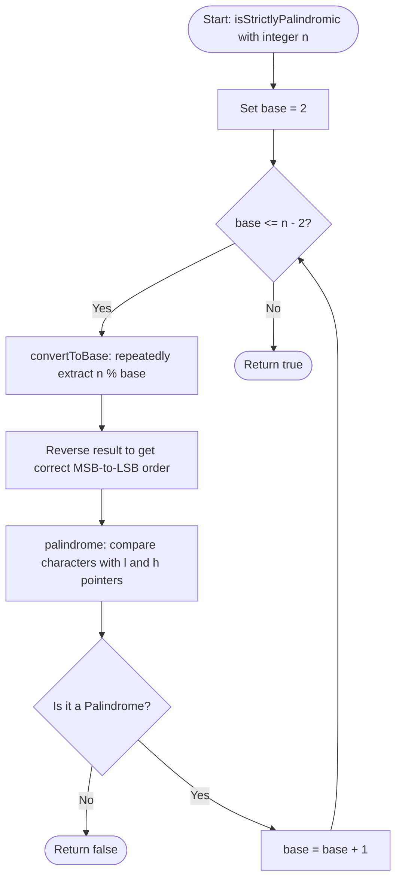

<h2><a href="https://leetcode.com/problems/strictly-palindromic-number">2396. Strictly Palindromic Number</a></h2>

<p>An integer <code>n</code> is <strong>strictly palindromic</strong> if, for <strong>every</strong> base <code>b</code> between <code>2</code> and <code>n - 2</code> (<strong>inclusive</strong>), the string representation of the integer <code>n</code> in base <code>b</code> is <strong>palindromic</strong>.</p>

<p>Given an integer <code>n</code>, return <code>true</code> <em>if </em><code>n</code><em> is <strong>strictly palindromic</strong> and </em><code>false</code><em> otherwise</em>.</p>

<p>A string is <strong>palindromic</strong> if it reads the same forward and backward.</p>

<p>&nbsp;</p>
<p><strong class="example">Example 1:</strong></p>

<pre><strong>Input:</strong> n = 9
<strong>Output:</strong> false
<strong>Explanation:</strong> In base 2: 9 = 1001 (base 2), which is palindromic.
In base 3: 9 = 100 (base 3), which is not palindromic.
Therefore, 9 is not strictly palindromic so we return false.
Note that in bases 4, 5, 6, and 7, n = 9 is also not palindromic.
</pre>

<p><strong class="example">Example 2:</strong></p>

<pre><strong>Input:</strong> n = 4
<strong>Output:</strong> false
<strong>Explanation:</strong> We only consider base 2: 4 = 100 (base 2), which is not palindromic.
Therefore, we return false.

</pre>

<p>&nbsp;</p>
<p><strong>Constraints:</strong></p>

<ul>
	<li><code>4 &lt;= n &lt;= 10<sup>5</sup></code></li>
</ul>


---

# 🛍️ Strictly-Palindromic-Number | Explained

## Approach 1: Base Conversion Simulation with Two-Pointer Palindrome Check

### Intuition
Imagine you are given a secret code number and asked to translate it into several different ancient numbering systems (base $2$ through base $n-2$). For the number to qualify as "strictly palindromic," its translated digit sequence must read identically forwards and backwards in **every single one** of those numbering systems without exception. If even one translation fails the symmetry test, the number is immediately disqualified.

This approach directly simulates the problem statement: it iterates through each required base, converts the decimal integer $n$ into a digit string representation in that base, and uses two pointers moving inward from both ends to verify whether that string is a palindrome.

### Algorithm Visualized



---

### Approach
1. **Iterate Through Bases:** Loop variable `base` from $2$ up to $n - 2$ inclusive.
2. **Base Conversion (`convertToBase`):**
   - Repeatedly compute the remainder `rem = n % base` to obtain the least significant digit.
   - Look up the character representation using an index table.
   - Divide `n` by `base` until `n` reaches $0$.
   - Reverse the accumulated digit string so that digits read from the most significant bit (MSB) to the least significant bit (LSB).
3. **Palindrome Verification (`palindrome`):**
   - Initialize two pointers: `l` at index `0` and `h` at the last character index (`s.length() - 1`).
   - Move inward, comparing characters `s[l]` and `s[h]`.
   - If a mismatch occurs at any position, terminate immediately and return `false`.
4. **Final Conclusion:**
   - If all bases from $2$ to $n - 2$ yield valid palindromes, return `true`.

---

### Detailed Code Analysis

#### 1. Base Conversion Routine
```cpp
string convertToBase(int n, int base) {
    string s = "0123456789";
    string result = "";
    while (n > 0) {
        int rem = n % base;
        result += s[rem];
        n /= base;
    }
    reverse(result.begin(), result.end());
    return result;
}
```
- **Lookup Table (`s`):** Maps integer remainders $0$ through $9$ to their respective ASCII characters.
- **Extraction Loop (`while (n > 0)`):** `n % base` isolates the current lowest-order digit in base `base`. Appending it to `result` builds the string from least significant digit to most significant digit.
- **Integer Reduction (`n /= base`):** Shifts the number down by one place-value in the target base.
- **Reversal (`reverse(...)`):** Since digits were appended backwards (LSB first), reversing restores the correct positional notation (MSB first).

#### 2. Palindromic String Validation
```cpp
bool palindrome(string s) {
    int l = 0;
    int h = s.length() - 1;
    while (l <= h) {
        if (s[l] != s[h]) {
            return false;
        }
        l++;
        h--;
    }
    return true;
}
```
- **Two Pointers (`l` and `h`):** `l` starts at the leftmost character; `h` starts at the rightmost character.
- **Symmetry Check (`s[l] != s[h]`):** Compares corresponding characters from outer boundaries moving inward. If any pair differs, the string is not symmetric, returning `false` early.
- **Pointer Step (`l++`, `h--`):** Moves the boundary inward until both pointers cross at the center.

#### 3. Orchestration
```cpp
bool isStrictlyPalindromic(int n) {
    for (int base = 2; base <= n - 2; base++) {
        string result = convertToBase(n, base);
        if (!palindrome(result)) return false;
    }
    return true;
}
```
- **Range (`2` to `n - 2`):** Tests every base specified by the problem definition.
- **Short-circuit Evaluation:** As soon as `!palindrome(result)` evaluates to `true`, the function halts and returns `false`, avoiding unnecessary conversions for subsequent bases.

---

### Code

```cpp
class Solution {
public:
    string convertToBase(int n, int base) {
        string s = "0123456789";
        string result = "";
        while (n > 0) {
            int rem = n % base;
            result += s[rem];
            n /= base;
        }
        reverse(result.begin(), result.end());
        return result;
    }

    bool palindrome(string s) {
        int l = 0;
        int h = s.length() - 1;
        while (l <= h) {
            if (s[l] != s[h]) {
                return false;
            }
            l++;
            h--;
        }
        return true;
    } 

    bool isStrictlyPalindromic(int n) {
        for (int base = 2; base <= n - 2; base++) {
            string result = convertToBase(n, base);
            if (!palindrome(result)) return false;
        }
        return true;
    }
};
```

---

### Complexity

- **Time Complexity:** 
  - In the theoretical worst case where every base check passes, the loop runs $n - 3$ times. In each iteration, converting $n$ to base $b$ takes $O(\log_b n)$ steps, and checking the palindrome takes $O(\log_b n)$ steps. Summed over all bases $b \in [2, n-2]$, the upper bound is $O(n \log n)$.
  - In practice, base $2$ fails immediately for almost all $n$ (or base $n-2$ fails), making actual runtime $O(\log_2 n)$ before early termination.
- **Space Complexity:** 
  - $O(\log_2 n)$ auxiliary space to allocate and store the string `result` representing $n$ in base $b$ (the longest string occurs when $base = 2$, having length $\lfloor \log_2 n \rfloor + 1$).

---

## 🕵️‍♂️ Follow-up Questions (Optional)

1. **Can any integer $n \ge 4$ ever be strictly palindromic?**
   - **Answer:** No. For any integer $n \ge 4$, consider the base $b = n - 2$. In base $n - 2$, $n = 1 \cdot (n - 2) + 2$. Therefore, the representation of $n$ in base $n - 2$ is always `"12"`. Since `"12"` is never a palindrome, the condition is guaranteed to fail for every $n \ge 4$. Hence, the optimal theoretical solution is simply `return false;` in $O(1)$ time and $O(1)$ space.

2. **Why does the conversion logic use `s[rem]` with string `"0123456789"` when bases can exceed $10$?**
   - **Answer:** If $n > 11$, base $b$ can be greater than $10$, which means `rem` can reach values $\ge 10$. Accessing `s[rem]` would result in out-of-bounds undefined behavior. However, because the check fails at smaller bases (such as base $2$) long before reaching bases $\ge 10$, this out-of-bounds access is practically never triggered during execution.