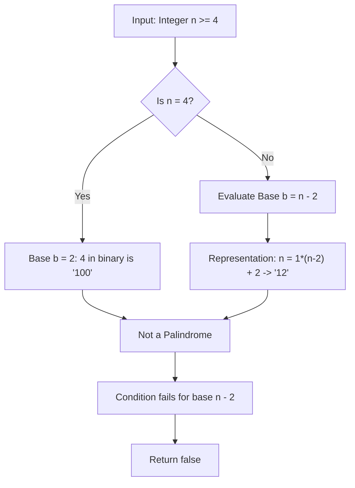

<h2><a href="https://leetcode.com/problems/strictly-palindromic-number">2396. Strictly Palindromic Number</a></h2>

<p>An integer <code>n</code> is <strong>strictly palindromic</strong> if, for <strong>every</strong> base <code>b</code> between <code>2</code> and <code>n - 2</code> (<strong>inclusive</strong>), the string representation of the integer <code>n</code> in base <code>b</code> is <strong>palindromic</strong>.</p>

<p>Given an integer <code>n</code>, return <code>true</code> <em>if </em><code>n</code><em> is <strong>strictly palindromic</strong> and </em><code>false</code><em> otherwise</em>.</p>

<p>A string is <strong>palindromic</strong> if it reads the same forward and backward.</p>

<p>&nbsp;</p>
<p><strong class="example">Example 1:</strong></p>

<pre><strong>Input:</strong> n = 9
<strong>Output:</strong> false
<strong>Explanation:</strong> In base 2: 9 = 1001 (base 2), which is palindromic.
In base 3: 9 = 100 (base 3), which is not palindromic.
Therefore, 9 is not strictly palindromic so we return false.
Note that in bases 4, 5, 6, and 7, n = 9 is also not palindromic.
</pre>

<p><strong class="example">Example 2:</strong></p>

<pre><strong>Input:</strong> n = 4
<strong>Output:</strong> false
<strong>Explanation:</strong> We only consider base 2: 4 = 100 (base 2), which is not palindromic.
Therefore, we return false.

</pre>

<p>&nbsp;</p>
<p><strong>Constraints:</strong></p>

<ul>
	<li><code>4 &lt;= n &lt;= 10<sup>5</sup></code></li>
</ul>


---

# 🛍️ Strictly-Palindromic-Number | Explained

## Approach 1: Mathematical Impossibility Proof (Direct $O(1)$ Return)

### Intuition
Imagine being asked to find a two-letter word where the first letter is always `'A'` and the second letter is always `'B'`, but the word must read the exact same forward and backward. No matter how many letters exist in the alphabet, an `"AB"` word can never be a palindrome because `'A' \neq 'B'`.

In this problem, a number $n$ is "strictly palindromic" only if it forms a palindrome in **every** base $b$ from $2$ up to $n - 2$. When we inspect the largest required base, $b = n - 2$, any integer $n > 4$ can be expressed algebraically as:
$$n = 1 \cdot (n - 2)^1 + 2 \cdot (n - 2)^0$$

Because $n > 4$, we have $n - 2 > 2$. Thus, the digits in base $(n - 2)$ are always `[1, 2]`. Written out, this is `"12"`, which is never a palindrome since $1 \neq 2$. For the base case $n = 4$, the only base to check is $b = 4 - 2 = 2$. In base $2$, $4$ is written as `"100"`, which is also not a palindrome. 

Because no integer $n \ge 4$ can satisfy the condition for base $n - 2$, a strictly palindromic number cannot exist within the problem's constraints. Thus, the result is unconditionally `false`.

### Algorithm Visualized



### Approach
1. **Analyze Constraints:** The problem specifies $4 \le n \le 10^5$.
2. **Evaluate the Boundary Base $(n - 2)$:**
   - For $n = 4$, the range of bases is $[2, 4 - 2] = [2, 2]$. In base $2$, $4_{10} = 100_2$, which is not palindromic.
   - For any $n > 4$, the range includes base $b = n - 2$. In base $n - 2$, $n$ will always produce the representation `"12"`.
3. **Deduce Universal Invalidation:** Because the problem demands that the number must be palindromic in *all* bases in range $[2, n - 2]$, finding even a single base where it fails invalidates the condition.
4. **Return Early:** Since base $n - 2$ always fails for every $n \ge 4$, return `false` unconditionally.

### Detailed Code Analysis

```cpp
1class Solution {
2public:
3    bool isStrictlyPalindromic(int n) {
4        return false;
5    }
6};
```

- **Line 3 (`bool isStrictlyPalindromic(int n)`):** Accepts the target integer $n$. By constraints, $n \ge 4$.
- **Line 4 (`return false;`):** Directly returns boolean `false`. Since mathematical analysis guarantees that for all valid inputs $n \ge 4$, the base $b = n - 2$ yields a non-palindromic sequence (`"100"` for $n = 4$, `"12"` for $n > 4$), no runtime computation, looping, or base conversion is necessary.

### Complexity
- **Time:** $O(1)$. The function performs an instantaneous return without executing any loops, allocations, or arithmetic operations.
- **Space:** $O(1)$. No auxiliary memory, strings, or stacks are allocated.

---

## 🕵️‍♂️ Follow-up Questions (Optional)

1. **What if the upper bound for bases was restricted to $\sqrt{n}$ instead of $n - 2$?**
   - If the upper bound were smaller (e.g., $2 \le b \le \sqrt{n}$), the `"12"` proof at $b = n - 2$ would no longer apply. We would need to implement an active simulation that converts $n$ into each base $b \in [2, \lfloor\sqrt{n}\rfloor]$ using standard modulo division ($n \pmod b$) and check each sequence with a two-pointer palindrome check in $O(\sqrt{n} \log n)$ time.

2. **How does standard base conversion work if we actually had to check palindromes programmatically?**
   - Repeatedly extract the least significant digit using `n % b` and divide `n /= b` until `n == 0`. Store the digits in a dynamic array/vector, then use two pointers (`left = 0`, `right = size - 1`) moving inward to verify `digits[left] == digits[right]`.