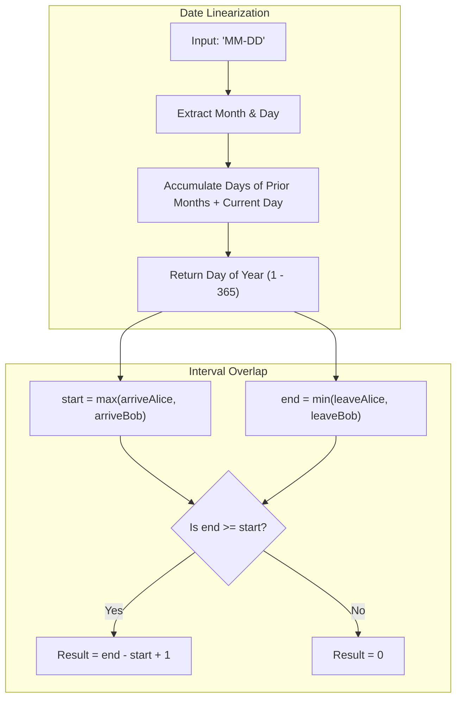

<h2><a href="https://leetcode.com/problems/count-days-spent-together">2409. Count Days Spent Together</a></h2>

<p>Alice and Bob are traveling to Rome for separate business meetings.</p>

<p>You are given 4 strings <code>arriveAlice</code>, <code>leaveAlice</code>, <code>arriveBob</code>, and <code>leaveBob</code>. Alice will be in the city from the dates <code>arriveAlice</code> to <code>leaveAlice</code> (<strong>inclusive</strong>), while Bob will be in the city from the dates <code>arriveBob</code> to <code>leaveBob</code> (<strong>inclusive</strong>). Each will be a 5-character string in the format <code>"MM-DD"</code>, corresponding to the month and day of the date.</p>

<p>Return<em> the total number of days that Alice and Bob are in Rome together.</em></p>

<p>You can assume that all dates occur in the <strong>same</strong> calendar year, which is <strong>not</strong> a leap year. Note that the number of days per month can be represented as: <code>[31, 28, 31, 30, 31, 30, 31, 31, 30, 31, 30, 31]</code>.</p>

<p>&nbsp;</p>
<p><strong class="example">Example 1:</strong></p>

<pre><strong>Input:</strong> arriveAlice = "08-15", leaveAlice = "08-18", arriveBob = "08-16", leaveBob = "08-19"
<strong>Output:</strong> 3
<strong>Explanation:</strong> Alice will be in Rome from August 15 to August 18. Bob will be in Rome from August 16 to August 19. They are both in Rome together on August 16th, 17th, and 18th, so the answer is 3.
</pre>

<p><strong class="example">Example 2:</strong></p>

<pre><strong>Input:</strong> arriveAlice = "10-01", leaveAlice = "10-31", arriveBob = "11-01", leaveBob = "12-31"
<strong>Output:</strong> 0
<strong>Explanation:</strong> There is no day when Alice and Bob are in Rome together, so we return 0.
</pre>

<p>&nbsp;</p>
<p><strong>Constraints:</strong></p>

<ul>
	<li>All dates are provided in the format <code>"MM-DD"</code>.</li>
	<li>Alice and Bob's arrival dates are <strong>earlier than or equal to</strong> their leaving dates.</li>
	<li>The given dates are valid dates of a <strong>non-leap</strong> year.</li>
</ul>


---

# 🛍️ Count-Days-Spent-Together | Explained

## Approach 1: 1D Interval Intersection via Day-of-Year Linearization

### Intuition
Think of a year not as a series of 12 separate monthly grids, but as a single, continuous tape measure marked from day $1$ to day $365$. 

When Alice and Bob give their arrival and departure dates, they are marking intervals on this tape measure: Alice is present from $[A_{\text{start}}, A_{\text{end}}]$ and Bob is present from $[B_{\text{start}}, B_{\text{end}}]$. To find the days they spent together, we simply need to find the intersection of these two line segments. The earliest they can be together is the latest arrival date ($\max(A_{\text{start}}, B_{\text{start}})$), and the latest they can be together is the earliest departure date ($\min(A_{\text{end}}, B_{\text{end}})$). If the overlap window is valid, the number of days is the length of that overlapping segment; otherwise, they spent $0$ days together.

### Algorithm Visualized



### Approach
1. **Date Serialization (`toDays`)**:
   - Parse the month and day from the format `"MM-DD"`.
   - Use an array holding the days of each month in a standard non-leap year: `[31, 28, 31, 30, 31, 30, 31, 31, 30, 31, 30, 31]`.
   - Calculate the prefix sum of all days in the months preceding the target month, and add the target day to yield a single integer representing the absolute day of the year (ranging from $1$ to $365$).
2. **Intersection Calculation**:
   - Find the effective arrival date: `start = max(arriveAlice_day, arriveBob_day)`.
   - Find the effective departure date: `end = min(leaveAlice_day, leaveBob_day)`.
3. **Clamp and Return**:
   - The number of days between two inclusive points $x$ and $y$ is $y - x + 1$.
   - If Alice leaves before Bob arrives (or vice versa), `end < start`, making `end - start + 1` negative. We guard against this by using `max(0, end - start + 1)`.

### Detailed Code Analysis

- **Lines 7–15: The `toDays` Lambda Function**
  ```cpp
  auto toDays = [](string s){
      int month = stoi(s.substr(0, 2));
      int day = stoi(s.substr(3, 2));
      int days[] = {31, 28, 31, 30, 31, 30, 31, 31, 30, 31, 30, 31};
      int total = day;
      for (int i = 0; i < month - 1; i++)
          total += days[i];
      return total;
  };
  ```
  - `s.substr(0, 2)` isolates the 2-digit month string, and `stoi()` parses it into a base-10 integer.
  - `s.substr(3, 2)` skips the hyphen at index `2` and isolates the 2-digit day string.
  - `days[]` acts as a static lookup table for the number of days in months 1 through 12.
  - The loop runs `month - 1` times. For example, if `month == 3` (March), it sums `days[0]` (January: 31) and `days[1]` (February: 28), then adds `day` (March's current day offset), accurately transforming 2D calendar dates into a 1D scalar coordinate.

- **Lines 16–17: Finding Interval Bounds**
  ```cpp
  int start = max(toDays(arriveAlice), toDays(arriveBob));
  int end = min(toDays(leaveAlice), toDays(leaveBob));
  ```
  - `start` is the latest of the two arrivals. They cannot be together before both have arrived.
  - `end` is the earliest of the two departures. They cannot be together after either has left.

- **Line 18: Evaluating Overlap**
  ```cpp
  return max(0, end - start + 1);
  ```
  - Since both arrival and departure days are inclusive, an overlap where `start == end` means they shared exactly $1$ day (`end - start + 1 = 1`).
  - If their visits do not overlap, `end < start`, causing `end - start + 1 <= 0`. `max(0, ...)` cleanly catches this boundary condition without needing an explicit `if-else` branch.

### Code

```cpp
#include <bits/stdc++.h>
using namespace std;

class Solution {
public:
    int countDaysTogether(string arriveAlice, string leaveAlice, string arriveBob, string leaveBob) {
        auto toDays = [](string s) {
            int month = stoi(s.substr(0, 2));
            int day = stoi(s.substr(3, 2));
            int days[] = {31, 28, 31, 30, 31, 30, 31, 31, 30, 31, 30, 31};
            int total = day;
            for (int i = 0; i < month - 1; i++)
                total += days[i];
            return total;
        };
        int start = max(toDays(arriveAlice), toDays(arriveBob));
        int end = min(toDays(leaveAlice), toDays(leaveBob));
        return max(0, end - start + 1);
    }
};
```

### Complexity
- **Time Complexity:** $\mathcal{O}(1)$. The input strings are fixed at $5$ characters. The `toDays` helper loops at most $11$ times. All arithmetic operations, conversions, and comparisons execute in strictly bounded, constant time.
- **Space Complexity:** $\mathcal{O}(1)$. Memory allocation is limited to a fixed-size integer array of $12$ elements and a few scalar integer variables. No dynamic memory is allocated on the heap.

## 🕵️‍♂️ Follow-up Questions (Optional)

1. **How would you extend this solution if the dates spanned across leap years or multiple years?**
   - Incorporate the year parameter (`"YYYY-MM-DD"`). Implement a helper function `isLeapYear(int year)` where a year is a leap year if `(year % 4 == 0 && year % 100 != 0) || (year % 400 == 0)`.
   - Convert dates into an epoch offset (days passed since a fixed base year, like 1970) by accumulating $365$ or $366$ days for each intermediate year, plus the normalized day-of-year. The interval intersection formula `max(0, min(end1, end2) - max(start1, start2) + 1)` remains identical.

2. **How would you handle finding the shared days among $K$ people instead of just 2?**
   - Generalized interval intersection: The mutual overlap for $K$ individuals is bounded by `start = max(arrive_1, arrive_2, ..., arrive_K)` and `end = min(leave_1, leave_2, ..., leave_K)`.
   - In streaming fashion, maintain running variables `globalStart = max(globalStart, arrive_i)` and `globalEnd = min(globalEnd, leave_i)`, taking $\mathcal{O}(K)$ time and $\mathcal{O}(1)$ extra space.