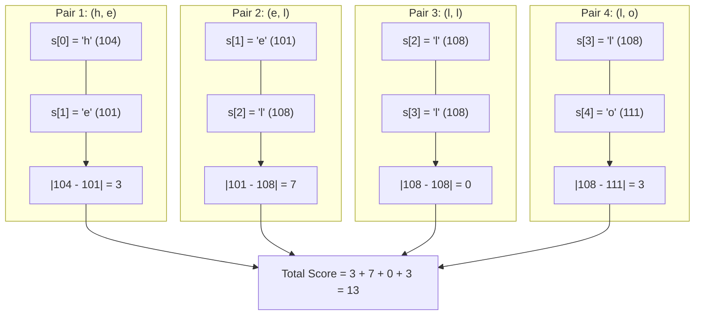

<h2><a href="https://leetcode.com/problems/score-of-a-string">3110. Score of a String</a></h2>

<p>You are given a string <code>s</code>. The <strong>score</strong> of a string is defined as the sum of the absolute difference between the <strong>ASCII</strong> values of adjacent characters.</p>

<p>Return the <strong>score</strong> of<em> </em><code>s</code>.</p>

<p>&nbsp;</p>
<p><strong class="example">Example 1:</strong></p>

<div class="example-block">
<p><strong>Input:</strong> <span class="example-io">s = "hello"</span></p>

<p><strong>Output:</strong> <span class="example-io">13</span></p>

<p><strong>Explanation:</strong></p>

<p>The <strong>ASCII</strong> values of the characters in <code>s</code> are: <code>'h' = 104</code>, <code>'e' = 101</code>, <code>'l' = 108</code>, <code>'o' = 111</code>. So, the score of <code>s</code> would be <code>|104 - 101| + |101 - 108| + |108 - 108| + |108 - 111| = 3 + 7 + 0 + 3 = 13</code>.</p>
</div>

<p><strong class="example">Example 2:</strong></p>

<div class="example-block">
<p><strong>Input:</strong> <span class="example-io">s = "zaz"</span></p>

<p><strong>Output:</strong> <span class="example-io">50</span></p>

<p><strong>Explanation:</strong></p>

<p>The <strong>ASCII</strong> values of the characters in <code>s</code> are: <code>'z' = 122</code>, <code>'a' = 97</code>. So, the score of <code>s</code> would be <code>|122 - 97| + |97 - 122| = 25 + 25 = 50</code>.</p>
</div>

<p>&nbsp;</p>
<p><strong>Constraints:</strong></p>

<ul>
	<li><code>2 &lt;= s.length &lt;= 100</code></li>
	<li><code>s</code> consists only of lowercase English letters.</li>
</ul>


---

# 🛍️ Score-of-a-String | Explained

## Approach 1: Single-Pass Adjacent Difference Accumulation

### Intuition
Imagine walking along a chain of mountain peaks where each character in the string represents a peak whose elevation is determined by its ASCII value. The "score" of the journey is the total vertical distance traveled between each consecutive peak, regardless of whether you are climbing up or descending down. 

Because we only care about transitions between immediate neighbors, we do not need to look forward beyond the next step or look back at where we have already been. A simple linear walkthrough of the string, evaluating the distance between adjacent pairs and adding them to a running tally, is all that is required.

### Algorithm Visualized

For the input string `s = "hello"`:



### Approach
1. **Initialize an accumulator**: Declare an integer variable `score` initialized to `0` to hold the running sum of absolute differences.
2. **Iterate adjacent pairs**: Loop through the string with an index `i` running from `0` to `s.size() - 2`. Stopping at `s.size() - 2` ensures that the adjacent access `s[i + 1]` stays strictly within bounds up to the final character at index `s.size() - 1`.
3. **Compute the absolute difference**:
   - Access the current character `s[i]` and the subsequent character `s[i + 1]`.
   - Subtract the two values. In C++, `char` types are automatically promoted to signed integers during arithmetic operations, avoiding character overflow or underflow issues.
   - Apply `abs()` to retrieve the non-negative magnitude of the difference.
4. **Accumulate and return**: Add this absolute difference to `score`. Once the loop terminates, return the computed `score`.

### Detailed Code Analysis

```cpp
class Solution {
public:
    int scoreOfString(string s) {
        int score = 0;
        for (int i = 0; i < s.size() - 1; ++i) {
            score += abs(s[i] - s[i + 1]);
        }
        return score;
    }
};
```

- **Line 4 (`int score = 0;`)**: A 32-bit signed integer is chosen as the accumulator. Given that standard lowercase ASCII values range from $97$ (`'a'`) to $122$ (`'z'`), the maximum absolute difference between any two characters is $|122 - 97| = 25$. For a string length up to $100$, the maximum score is $25 \times 99 = 2475$, which easily fits in a standard integer without risk of overflow.
- **Line 5 (`for (int i = 0; i < s.size() - 1; ++i)`)**: 
  - The loop condition uses `s.size() - 1`. Because the problem guarantees $2 \le s.length \le 100$, `s.size()` is at least $2$, so `s.size() - 1` evaluates to at least $1$. This guarantees safety against unsigned underflow of `std::size_t`.
  - The pre-increment operator `++i` advances the index pointer by one element each cycle without creating a temporary copy of `i`.
- **Line 6 (`score += abs(s[i] - s[i + 1]);`)**:
  - `s[i]` and `s[i + 1]` fetch the characters at consecutive indices.
  - Due to integral promotion rules in C++, both `char` operands are promoted to `int` before subtraction, guaranteeing that values like `97 - 100` correctly evaluate to `-3`.
  - `abs(...)` resolves to `std::abs(int)` from the standard library, returning the magnitude.
  - `+=` updates the running tally in place.
- **Line 8 (`return score;`)**: Returns the accumulated integer sum directly to the caller.

### Code
```cpp
class Solution {
public:
    int scoreOfString(string s) {
        int score = 0;
        for (int i = 0; i < s.size() - 1; ++i) {
            score += abs(s[i] - s[i + 1]);
        }
        return score;
    }
};
```

### Complexity
- **Time:** $O(N)$, where $N$ is the length of the string `s`. The algorithm inspects each character pair exactly once across $N - 1$ iterations. Inside the loop, indexing, subtraction, absolute value computation, and addition are all $O(1)$ primitive operations.
- **Space:** $O(1)$ auxiliary space. The calculation is done in place with a single scalar integer variable `score` and a loop counter `i`, requiring no additional dynamic heap or stack allocations.

---

## 🕵️‍♂️ Follow-up Questions (Optional)

1. **Unsigned Underflow Trap:** What bug would occur in line 5 if the constraints allowed an empty string (`s.size() == 0`)?
   - *Answer:* `s.size()` returns an unsigned type (`size_t`). If `s.size()` is `0`, evaluating `s.size() - 1` results in unsigned arithmetic underflow, wrapping around to `SIZE_MAX` (e.g., $18,446,744,073,709,551,615$ on 64-bit systems). The loop condition `i < s.size() - 1` would evaluate to true, causing `s[i]` and `s[i + 1]` to access invalid memory and trigger a segmentation fault. A safer approach for unbounded inputs is `i + 1 < s.size()` or casting `static_cast<int>(s.size()) - 1`.

2. **SIMD / Vectorization Potential:** How would you optimize this logic if `s` contained hundreds of millions of characters?
   - *Answer:* Because each adjacent absolute difference is independent, the operations can be parallelized using SIMD (Single Instruction, Multiple Data) intrinsics (such as AVX2 or AVX-512). One can load 32 or 64 bytes at a time into vector registers, perform an unaligned shift/load for the adjacent elements, compute differences using saturated vector subtraction (`_mm256_sub_epi8` / absolute difference intrinsics `_mm256_abs_epi8`), and perform a horizontal reduction at the end to achieve near-memory-bandwidth throughput.