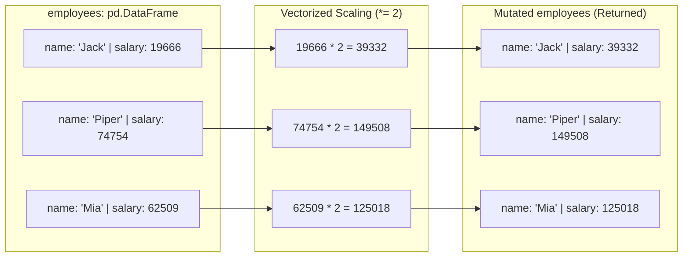

<h2><a href="https://leetcode.com/problems/modify-columns">2884. Modify Columns</a></h2>

<pre>DataFrame <code>employees</code>
+-------------+--------+
| Column Name | Type   |
+-------------+--------+
| name        | object |
| salary      | int    |
+-------------+--------+
</pre>

<p>A company intends to give its employees a pay rise.</p>

<p>Write a solution to <strong>modify</strong> the <code>salary</code> column by multiplying each salary by 2.</p>

<p>The result format is in the following example.</p>

<p>&nbsp;</p>
<p><strong class="example">Example 1:</strong></p>

<pre><strong>Input:
</strong>DataFrame employees
+---------+--------+
| name    | salary |
+---------+--------+
| Jack    | 19666  |
| Piper   | 74754  |
| Mia     | 62509  |
| Ulysses | 54866  |
+---------+--------+
<strong>Output:
</strong>+---------+--------+
| name    | salary |
+---------+--------+
| Jack    | 39332  |
| Piper   | 149508 |
| Mia     | 125018 |
| Ulysses | 109732 |
+---------+--------+
<strong>Explanation:
</strong>Every salary has been doubled.</pre>


---

# 🛍️ Modify-Columns | Explained

## Approach 1: In-Place Vectorized Scaling via Attribute Access

### Intuition
Imagine an accountant reviewing a physical payroll ledger. Instead of transcribing every employee's name, ID, and department onto a brand-new ledger sheet just to double their earnings, the accountant focuses solely on the "Salary" column, erases each number, and writes in double the amount on the exact same paper. 

In Pandas, vectorized operations allow us to broadcast a scalar operation (multiplying by 2) across an entire Series at once. Using augmented assignment (`*=`) updates the column values directly within the existing DataFrame structure without rebuilding the surrounding table.

### Algorithm Visualized



### Approach
1. **Access the Target Column**: Reference the `salary` column using Pandas dot-notation (`employees.salary`).
2. **Apply Vectorized Arithmetic**: Apply an augmented scalar multiplication operator (`*= 2`). Pandas delegates this operation to NumPy under the hood, running optimized C/SIMD instructions across the contiguous memory buffer representing the salary column.
3. **Return the DataFrame**: Return the modified `employees` DataFrame reference.

### Detailed Code Analysis

```python
import pandas as pd

def modifySalaryColumn(employees: pd.DataFrame) -> pd.DataFrame:
    employees.salary *= 2
    return employees
```

- **Line 1: `import pandas as pd`**
  Loads the Pandas library, giving access to the high-performance `DataFrame` and `Series` structures backed by NumPy arrays.

- **Line 3: `def modifySalaryColumn(employees: pd.DataFrame) -> pd.DataFrame:`**
  Defines the function signature accepting an instance of `pd.DataFrame` and returning a `pd.DataFrame`. The type hints explicitly declare expected contracts.

- **Line 4: `employees.salary *= 2`**
  - `employees.salary`: Uses attribute-style access to extract the `salary` column as a `pd.Series`.
  - `*= 2`: Utilizes Python's in-place multiplication operator (`__imul__`). Behind the scenes, Pandas leverages NumPy broadcasting. It calculates the product for every element in the underlying array without an explicit Python-level `for` loop.
  - *Engineering Note on Attribute Access vs. Indexing*: While `employees.salary` works cleanly here, production code typically prefers index syntax (`employees['salary'] *= 2`). Attribute access will fail if a column name contains spaces, special characters, or collides with existing DataFrame methods/attributes (such as `count`, `size`, `shape`, or `mean`).

- **Line 5: `return employees`**
  Returns the original DataFrame reference. Because the mutation was performed directly on the object passed into the function, no additional DataFrame construction or re-indexing is required.

### Code
```python
import pandas as pd

def modifySalaryColumn(employees: pd.DataFrame) -> pd.DataFrame:
    employees.salary *= 2
    return employees
```

### Complexity
- **Time Complexity:** $\mathcal{O}(N)$, where $N$ is the number of rows in `employees`. The multiplication operation iterates through all $N$ elements in the `salary` column once. Because Pandas executes this via compiled NumPy C-loops rather than dynamic Python bytecode iterations, the constant factor is exceptionally low.
- **Space Complexity:** $\mathcal{O}(1)$ auxiliary space. The operation modifies the Series data in-place without duplicating the entire DataFrame. (Note: Under modern Pandas with Copy-on-Write enabled, a temporary array may be allocated internally to ensure reference safety before replacing the column block, which temporarily requires $\mathcal{O}(N)$ memory, but the net external auxiliary space overhead remains $\mathcal{O}(1)$).

---

## 🕵️‍♂️ Follow-up Questions

### 1. Why is `employees['salary']` generally preferred over `employees.salary` in production?
Attribute access (`employees.salary`) is syntactic sugar that introduces several edge cases:
- **Name Collisions:** If a column shares a name with a built-in DataFrame attribute or method (e.g., `min`, `max`, `plot`, `shape`), the attribute lookup resolves to the method instead of the Series, causing runtime errors or unexpected behavior.
- **Column Creation:** You cannot create *new* columns using attribute assignment (e.g., `employees.new_col = ...` attaches an attribute to the Python object rather than registering a DataFrame column).
- **Special Characters:** Column names containing whitespace, dashes, or starting with numbers cannot be accessed via dot notation.

### 2. How does Pandas 2.0's Copy-on-Write (CoW) affect this pattern?
With Pandas 2.0+ and Copy-on-Write enabled (`pd.options.mode.copy_on_write = True`), mutating a column directly can prevent silent bugs where slices of DataFrames unintentionally overwrite original data. If `employees` was created as a slice/view of another DataFrame, modifying `employees.salary` under CoW will lazily trigger a copy of only the `salary` array before mutating, avoiding unwanted side effects on the parent DataFrame and eliminating `SettingWithCopyWarning`.