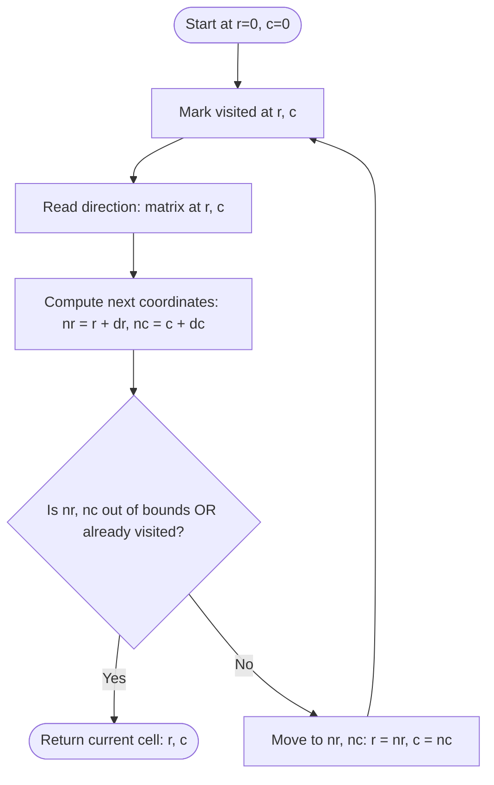

<h2><a href="https://leetcode.com/problems/last-visited-cell-in-a-directional-grid">4084. Last Visited Cell in a Directional Grid</a></h2>

<p>You are given an <code>m x n</code> matrix <code>grid</code> where each cell contains one of the following characters:</p>

<ul>
	<li><code>'L'</code>: move one cell left.</li>
	<li><code>'R'</code>: move one cell right.</li>
	<li><code>'U'</code>: move one cell up.</li>
	<li><code>'D'</code>: move one cell down.</li>
</ul>

<p>You start at cell <code>(0, 0)</code>, which is considered visited. At each step, move to the cell indicated by the character in your current cell.</p>

<p>The process <strong>ends</strong> if the indicated move would either leave the grid or enter a cell that has already been visited. In either case, the move is <strong>not</strong> made.</p>

<p>Return an integer array <code>[r, c]</code> representing the <strong>row and column indices</strong> of the <strong>last visited cell</strong>. The indices are <strong>0-based</strong>.</p>

<p>&nbsp;</p>
<p><strong class="example">Example 1:</strong></p>

<div class="example-block">
<p><strong>Input:</strong> <span class="example-io">grid = [["R","D"],["U","L"]]</span></p>

<p><strong>Output:</strong> <span class="example-io">[1,0]</span></p>

<p><strong>Explanation:</strong></p>

<ul>
	<li>Start at cell <code>(0, 0)</code>, which contains <code>'R'</code>, so move right to <code>(0, 1)</code>.</li>
	<li>At cell <code>(0, 1)</code>, the character is <code>'D'</code>, so move down to <code>(1, 1)</code>.</li>
	<li>At cell <code>(1, 1)</code>, the character is <code>'L'</code>, so move left to <code>(1, 0)</code>.</li>
	<li>At cell <code>(1, 0)</code>, the character is <code>'U'</code>, which indicates moving to <code>(0, 0)</code>. However, <code>(0, 0)</code> has already been visited, so this move is not made.</li>
	<li>Therefore, the process ends at the last visited cell <code>(1, 0)</code>, so the answer is <code>[1, 0]</code>.</li>
</ul>
</div>

<p><strong class="example">Example 2:</strong></p>

<div class="example-block">
<p><strong>Input:</strong> <span class="example-io">grid = [["R","R","R"]]</span></p>

<p><strong>Output:</strong> <span class="example-io">[0,2]</span></p>

<p><strong>Explanation:</strong></p>

<ul>
	<li>Start at cell <code>(0, 0)</code>, which contains <code>'R'</code>, so move right to <code>(0, 1)</code>.</li>
	<li>At cell <code>(0, 1)</code>, the character is <code>'R'</code>, so move right to <code>(0, 2)</code>.</li>
	<li>At cell <code>(0, 2)</code>, the character is <code>'R'</code>, which indicates moving to <code>(0, 3)</code>. However, <code>(0, 3)</code> is outside the grid, so this move is not made.</li>
	<li>Therefore, the process ends at the last visited cell <code>(0, 2)</code>, so the answer is <code>[0, 2]</code>.</li>
</ul>
</div>

<p>&nbsp;</p>
<p><strong>Constraints:</strong></p>

<ul>
	<li><code>1 &lt;= m == grid.length &lt;= 10<sup>5</sup></code></li>
	<li><code>1 &lt;= n == grid[i].length &lt;= 10<sup>5</sup></code></li>
	<li><code>m * n &lt;= 10<sup>5</sup></code></li>
	<li><code>grid[i][j]</code> is one of <code>'L'</code>, <code>'R'</code>, <code>'U'</code>, or <code>'D'</code>.</li>
</ul>


---

# 🛍️ Last-Visited-Cell-in-a-Directional-Grid | Explained

## Approach 1: Grid Simulation with Visited Matrix

### Intuition
Imagine walking through a warehouse where every floor tile has an arrow pointing in one of four directions (`'U'`, `'D'`, `'L'`, `'R'`). You start at the top-left tile `(0, 0)` and must follow the arrows strictly. To prevent walking in infinite circles, you drop a marker on each tile you step on. 

Before stepping onto the next tile indicated by the arrow, you look ahead:
1. Does the arrow point off the edge of the floor (out of bounds)?
2. Does the arrow point to a tile where you already dropped a marker (cycle detection)?

If either condition is met, you cannot move forward. You immediately halt, and the tile you are standing on is your last visited cell.

### Algorithm Visualized



### Approach
1. **Initialize Dimensions and State:** Retrieve grid row count `m` and column count `n`. Set starting point at coordinates `r = 0, c = 0`.
2. **Cycle Tracking:** Create an `m x n` boolean table initialized to `false` to track visited positions. Mark the starting cell `(0, 0)` as `true`.
3. **Deterministic Traversal Loop:**
   - Read the character at `matrix[r][c]`.
   - Compute the delta offsets `(dr, dc)` corresponding to `'L'`, `'R'`, `'U'`, or `'D'`.
   - Compute candidate coordinates: `nr = r + dr`, `nc = c + dc`.
   - Check termination guards:
     - Out-of-bounds: `nr < 0 || nr >= m || nc < 0 || nc >= n`
     - Repeated visit: `visited[nr][nc] == true`
   - If either condition holds, return the current cell `[r, c]`.
   - Otherwise, advance to `(nr, nc)`, mark `visited[nr][nc] = true`, and repeat.

### Detailed Code Analysis

```cpp
vector<vector<char>> matrix = grid;
int m = matrix.size();
int n = m > 0 ? matrix[0].size() : 0;
int r = 0, c = 0;
```
- **Copying the input:** `vector<vector<char>> matrix = grid;` performs a deep copy of the input grid. In an interview or production environment, this is redundant overhead unless grid mutation is strictly prohibited and needed downstream.
- **Dimension checks:** `m` and `n` are determined safely, including a ternary guard for empty grids (`m > 0 ? matrix[0].size() : 0`).
- **Pointers:** `r` and `c` track the current position, starting at `(0, 0)`.

```cpp
vector<vector<bool>> visited(m, vector<bool>(n, false));
visited[0][0] = true;
```
- Allocates an `m x n` table of booleans. `std::vector<bool>` is space-optimized (bitset under the hood in C++ standard libraries), consuming 1 bit per cell.
- Marks `(0, 0)` as visited before the loop begins to ensure an immediate revisit halts execution.

```cpp
while (true) {
    char move = matrix[r][c];
    int dr = 0, dc = 0;
    if (move == 'L') dc = -1;
    else if (move == 'R') dc = 1;
    else if (move == 'U') dr = -1;
    else if (move == 'D') dr = 1;

    int nr = r + dr;
    int nc = c + dc;
```
- **Delta mapping:** Resolves directional characters to unit vector translations `(dr, dc)`.
- **Lookahead:** Calculates `nr` and `nc` before moving the actual pointer. This prevents the state from becoming invalid if the next move leads out of bounds.

```cpp
    if (nr < 0 || nr >= m || nc < 0 || nc >= n || visited[nr][nc]) {
        return {r, c};
    }

    r = nr;
    c = nc;
    visited[r][c] = true;
}
```
- **Boundary & Loop Guard:** Short-circuit evaluation ensures `visited[nr][nc]` is only checked after `nr` and `nc` are verified to be within index ranges `[0, m - 1]` and `[0, n - 1]`.
- **Update:** If the move is valid, the current position advances to `(nr, nc)` and the cell is marked visited.

### Code
```cpp
class Solution {
public:
    vector<int> lastVisitedCell(vector<vector<char>>& grid) {
        int m = grid.size();
        if (m == 0) return {0, 0};
        int n = grid[0].size();
        if (n == 0) return {0, 0};

        int r = 0, c = 0;
        vector<vector<bool>> visited(m, vector<bool>(n, false));
        visited[0][0] = true;

        while (true) {
            char move = grid[r][c];
            int dr = 0, dc = 0;

            if (move == 'L') dc = -1;
            else if (move == 'R') dc = 1;
            else if (move == 'U') dr = -1;
            else if (move == 'D') dr = 1;

            int nr = r + dr;
            int nc = c + dc;

            // Stop if the move goes outside the grid or loops back
            if (nr < 0 || nr >= m || nc < 0 || nc >= n || visited[nr][nc]) {
                return {r, c};
            }

            r = nr;
            c = nc;
            visited[r][c] = true;
        }

        return {r, c};
    }
};
```

### Complexity
- **Time Complexity:** $\mathcal{O}(m \times n)$  
  Every cell in the grid is visited at most once. Because each step takes $\mathcal{O}(1)$ time to evaluate direction and boundary checks, the simulation will make at most $m \times n$ steps before either terminating out of bounds or encountering an already visited cell.
- **Space Complexity:** $\mathcal{O}(m \times n)$  
  Allocates an $m \times n$ auxiliary matrix `visited` to keep track of traversed cells. (Note: Avoiding the `matrix = grid` copy keeps space bounded strictly by the `visited` array).

---

## 🕵️‍♂️ Follow-up Questions

### 1. How can we optimize the auxiliary space to $\mathcal{O}(1)$?
If in-place mutation of the input `grid` is permitted, we can eliminate the `visited` array entirely. When leaving a cell `grid[r][c]`, we can overwrite it with a sentinel character (e.g., `'X'`) or flip its case. If the next step encounters `'X'`, we know a cycle has occurred.

### 2. What if $m$ and $n$ are very large (e.g., $10^5 \times 10^5$), but the path length is small?
Allocating an $m \times n$ matrix would result in an Out-Of-Memory (OOM) error. Instead, use a hash set of 64-bit integers (`std::unordered_set<long long>`) where each visited coordinate is hashed as `((long long)r << 32) | (unsigned int)c`. This reduces memory usage to $\mathcal{O}(L)$, where $L$ is the number of steps taken.